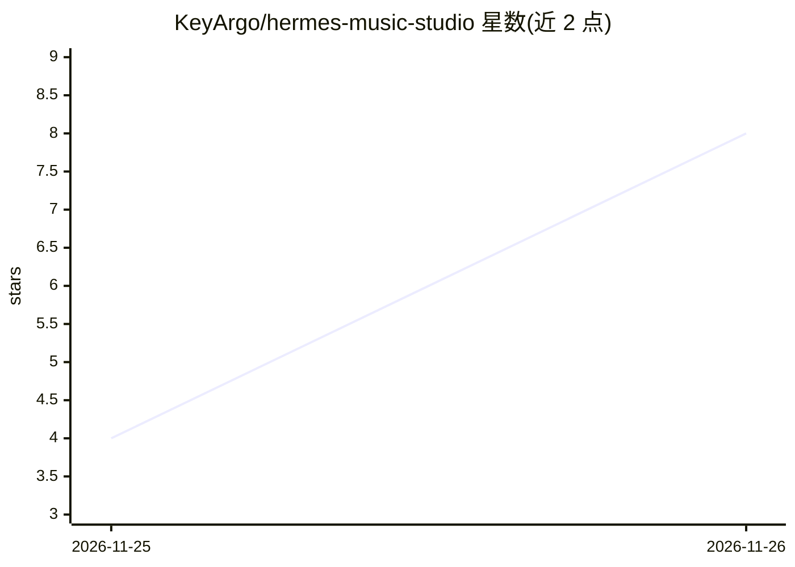

# KeyArgo/hermes-music-studio

⭐ 8 · Python · MIT · 推送 2026-11-25 · [GitHub](https://github.com/KeyArgo/hermes-music-studio) · 个人维护

**Hermes 插件：描述歌曲，草拟歌词与风格，经批准后本地渲染成曲**

作为 Hermes Agent 插件运行的音乐工作室：用户描述感受后生成标题、风格与歌词草稿，渲染端点拒绝未经批准的草稿；每次录制（take）保存草稿、种子与引擎信息以支持复现。渲染通过本机 ACE-Step 或经 ComfyUI 主机的 MiniMax Music 3 完成，支持分段重绘与自动拼接、录制质量检查（节奏/时长/削波等可测项）、聊天与 /song 斜杠命令驱动及 ms.py 命令行客户端。需 Python 3.13、Hermes 本体及可达的渲染引擎；支持 Linux/macOS，Windows 尚未支持。

## 筛选速览

| 维度 | 判定 | 备注 |
|---|---|---|
| AI 角色 | `ai-native` | 本体是模型或模型工具 |
| 许可风险 | `permissive` | MIT |
| 部署形态 | `library` | 以包/库形式分发 |
| 模型依赖 | — | README 未给出锁定关系 |
| 硬件要求 | — | 无带数字的原话,不猜 |
| 安装摩擦 | `low` | 无编译、无系统依赖或容器化 |
| 成熟度 | — | 结构信号不足 |

## 能力要点

- 批准门控：render 拒绝未带 updated_at 令牌批准的草稿
- take 记录草稿、seed 与引擎，ACE 可按 seed 精确重放
- 八秒内分段重绘并逐字节拼接回原曲
- 聊天工具 music_studio 与 /song 斜杠命令驱动完整流程

## 适用场景

- 先审阅歌词与风格草稿，确认后再渲染成歌
- 在 Hermes 对话中直接描述并完成整首歌
- 对已完成录制局部改词改风格而不影响其余部分

## 场景标签

`AI 写作` · 领域:内容生成

## 证据(README 行号)

> L14: A studio inside Hermes. You describe a feeling, the studio turns it into a draft with a title, style
> L189: - **No model ships here.** Rendering needs a reachable engine: a ComfyUI host running MiniMax Music 3,
> L8: The agent writes the song. You approve it. Your own machine renders it.

## 星数曲线

2026-11-25 4 → 2026-11-26 8（+4）

---
*卡片 v1 · prompt 1.4 · 生成 2026-11-24 · 置信度 mid · 依据 README sha `c140460e1231` · [字段定义](../../DATASET.md)*
