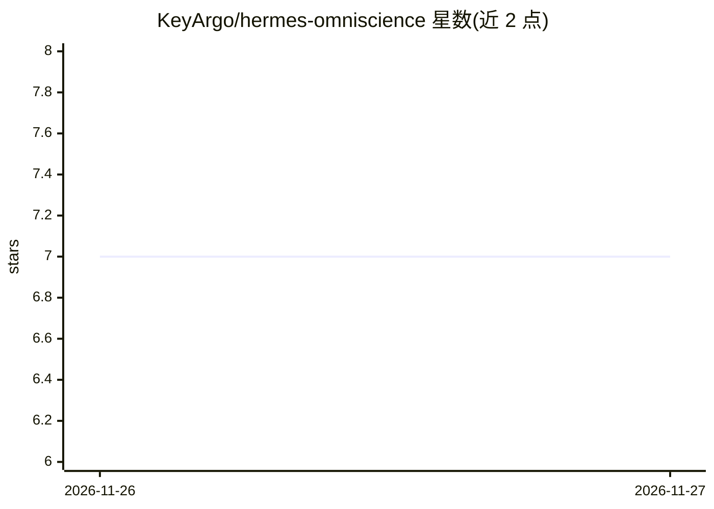

# KeyArgo/hermes-omniscience

⭐ 7 · Python · MIT · 推送 2026-11-26 · [GitHub](https://github.com/KeyArgo/hermes-omniscience) · 组织维护

**给 Hermes agent 的本地只读运行可视化与回放插件**

作为 Hermes agent 的插件，实时记录 agent 运行并绘制会话→轮次→模型调用→工具→子代理的执行图，支持逐步回放定位出错步骤。仅存储元数据（名称、时长、大小、状态），不保存 prompt、参数或输出，短文本字段经模式脱敏；写队列为有界 10,000 事件队列+SQLite，队列满则丢弃计数而不阻塞 agent。查看器仅绑定 loopback、只读、无远程访问模式，仅记录 Hermes 会话。

## 筛选速览

| 维度 | 判定 | 备注 |
|---|---|---|
| AI 角色 | `ai-ecosystem` | LLM/agent 周边工具 |
| 许可风险 | `permissive` | MIT |
| 部署形态 | `None` |  |
| 模型依赖 | — | README 未给出锁定关系 |
| 硬件要求 | — | 无带数字的原话,不猜 |
| 安装摩擦 | `low` | 无编译、无系统依赖或容器化 |
| 成熟度 | — | 结构信号不足 |

## 能力要点

- 实时执行图：sessions/turns/model calls/tools/subagents 一画布呈现
- 确定性回放，可回退到出错的具体步骤
- 只存元数据，prompt/参数/输出不入库，敏感模式脱敏
- 有界队列+后台批量写 SQLite，不阻塞 agent 运行

## 适用场景

- 实时观察长时 Hermes agent 运行而不翻日志
- 回放排查某一步工具调用或模型调用失败
- 在本地私密环境下审计 agent 行为，不外发 trace

## 场景标签

`LLM 可观测性` · 领域:评测与运维

## 证据(README 行号)

> L20: Omniscience records what your Hermes agent does, as it happens, and draws it as a graph you can read at a glance. Y
> L24: The graph is live and the replay is deterministic. Other tools import a finished trace or report on cost after the 

## 星数曲线

2026-11-26 7 → 2026-11-27 7（+0）

---
*卡片 v1 · prompt 1.4 · 生成 2026-11-26 · 置信度 high · 依据 README sha `9b167e3fdb8f` · [字段定义](../../DATASET.md)*
