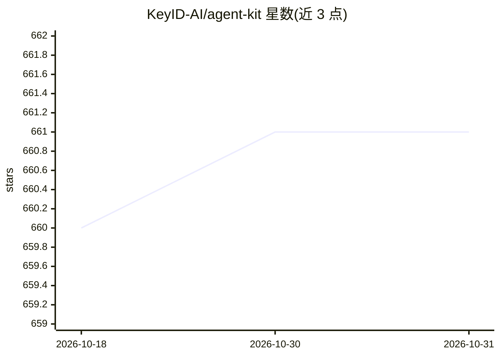

# KeyID-AI/agent-kit

⭐ 661 · JavaScript · 推送 2026-03-13 · [GitHub](https://github.com/KeyID-AI/agent-kit) · [官网](https://keyid.ai) · 组织维护

**给 Claude/Cursor 等 MCP 客户端接入真实邮箱的 27 个工具服务**

基于 Model Context Protocol（MCP JSON-RPC over stdio）的 npm 包，为 Claude Desktop、Cursor 及任意 MCP 客户端提供 27 个邮件工具：注册代理获取邮箱地址、收发/回复/转发邮件、会话与草稿管理、自动回复/签名/转发设置、联系人、Webhook、黑白名单与用量指标。底层依赖 KeyID.ai 免费邮件基础设施，无需人工注册与 API key，密钥默认自动生成。

## 筛选速览

| 维度 | 判定 | 备注 |
|---|---|---|
| AI 角色 | `ai-ecosystem` | LLM/agent 周边工具 |
| 许可风险 | `none` | — |
| 部署形态 | `library` | 以包/库形式分发 |
| 模型依赖 | — | README 未给出锁定关系 |
| 硬件要求 | — | 无带数字的原话,不猜 |
| 安装摩擦 | `low` | 无编译、无系统依赖或容器化 |
| 成熟度 | — | 结构信号不足 |

## 能力要点

- 27 个 MCP 邮件工具：收发/回复/转发/搜索/定时发送
- 代理注册即获邮箱地址，无需人工注册与 API key
- 支持 Claude Desktop、Cursor 及任意 MCP 客户端
- 提供 Webhook、黑白名单与用量指标查询

## 适用场景

- 让 Claude Desktop/Cursor 中的 AI 代理自主收发管理邮件
- 为自定义 MCP 客户端接入邮箱能力
- 通过 Webhook 跟踪邮件投递事件

## 场景标签

 · 领域:开发者工具/AI Agent 基础设施

## 证据(README 行号)

> L5: 27 email tools via Model Context Protocol (MCP): send, receive, reply, search inbox, manage contacts, set auto-reply
> L115: Uses MCP JSON-RPC over stdio (protocol version 2024-11-05). Compatible with Claude Desktop, Cursor, and any MCP cl

## 星数曲线

2026-10-18 660 → 2026-10-31 661（+1）

---
*卡片 v1 · prompt 1.4 · 生成 2026-10-21 · 置信度 high · 依据 README sha `28533e9f5aef` · [字段定义](../../DATASET.md)*
