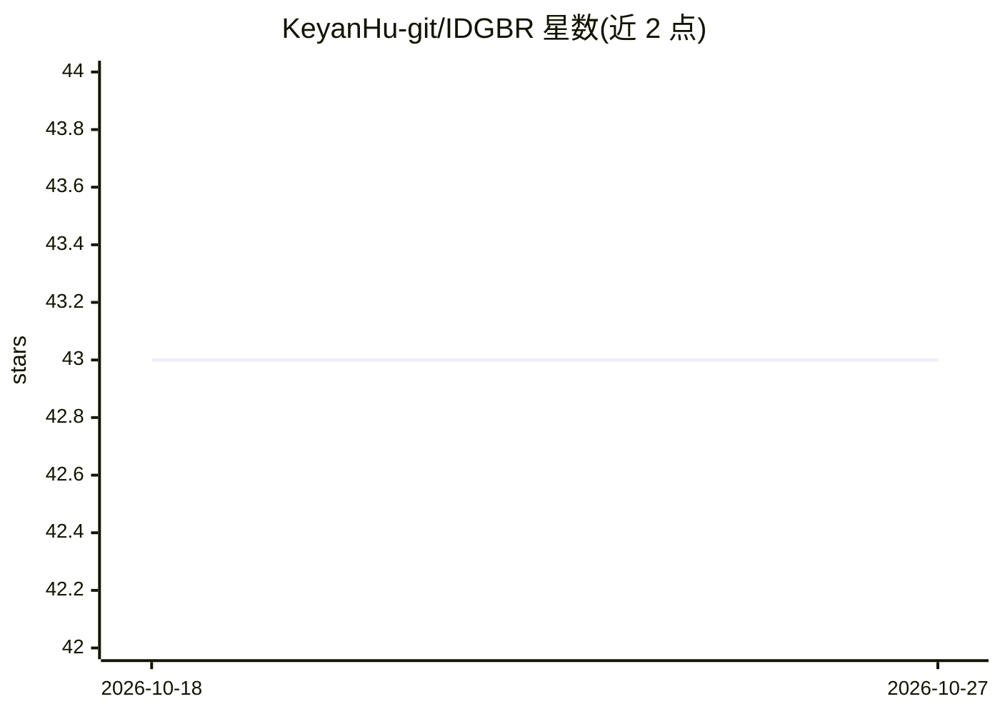

# KeyanHu-git/IDGBR

⭐ 43 · Jupyter Notebook · Apache-2.0 · 推送 2026-08-02 · [GitHub](https://github.com/KeyanHu-git/IDGBR) · 组织维护 · 中文 README

**遥感语义分割边界精化方法 IDGBR 的官方实现（TPAMI 2026）**

论文官方代码库：提出两阶段框架 IDGBR，Stage I 用冻结的判别式模型产生粗分割作为语义先验，Stage II 将图像与粗预测送入 latent diffusion 过程，由 Denoising U-Net 与 Conditional Guidance Net 恢复边界细节。提供 CHN6-CUG、Potsdam 等数据集的目录约定、Google Drive 示例数据包与预训练权重（含 Stable Diffusion v1.5、DINOv2 backbone）。训练/推理/评测通过 bash 脚本与配置文件运行，环境在 Linux、CUDA 11.7、PyTorch 2.0.1 上验证。

## 筛选速览

| 维度 | 判定 | 备注 |
|---|---|---|
| AI 角色 | `ai-native` | 本体是模型或模型工具 |
| 许可风险 | `permissive` | Apache-2.0 |
| 部署形态 | `library` | 以包/库形式分发 |
| 模型依赖 | — | README 未给出锁定关系 |
| 硬件要求 | — | 无带数字的原话,不猜 |
| 安装摩擦 | `medium` | 含编译或系统依赖之一 |
| 成熟度 | — | 结构信号不足 |

## 能力要点

- 两阶段框架：判别式粗分割先验 + diffusion 边界精化
- 提供 2 类与 8 类设置的预训练权重与标签嵌入网络
- 定义 IoU_imp 修复能力指标（真/假预测区域分别计算 IoU）
- 示例数据包覆盖 CHN6-CUG 与 Potsdam 数据集

## 适用场景

- 精化已有粗分割掩膜的边界
- 道路、建筑物、地物覆盖等遥感分割任务
- 复现论文训练与评测流程

## 场景标签

 · 领域:计算机视觉/遥感

## 证据(README 行号)

> L15: Remote sensing semantic segmentation requires both semantic correctness over large regions and precise localization
> L29: IDGBR follows a two-stage framework that combines discriminative coarse segmentation with diffusion-based boundary 

## 星数曲线

2026-10-18 43 → 2026-10-27 43（+0）

---
*卡片 v1 · prompt 1.4 · 生成 2026-10-25 · 置信度 mid · 依据 README sha `82c471465eac` · [字段定义](../../DATASET.md)*
