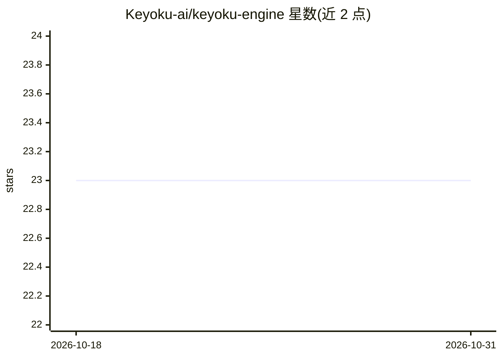

# Keyoku-ai/keyoku-engine

⭐ 23 · Go · NOASSERTION · 推送 2026-06-18 · [GitHub](https://github.com/Keyoku-ai/keyoku-engine) · [官网](https://keyoku.ai) · 组织维护

**给 AI agent 的本地记忆引擎：语义记忆、知识图谱与主动信号扫描**

纯 Go 实现的 AI agent 记忆后端，作为库或 HTTP 服务器（SQLite + 进程内 HNSW）本地运行。记忆从对话中抽取，按语义去重合并，按 Ebbinghaus 曲线衰减并有访问强化；自动从对话构建实体/关系知识图谱（40+ 关系类型，最多 5 跳遍历）。heartbeat 子系统以零 token 的 12 类 SQL 信号扫描（截止日期、目标进展、情绪变化等）结合图谱上下文，经 LLM 编译为行动建议；该子系统未被 Keyoku harness 使用，注明将被更精简的触发扫描取代。支持 Gemini/OpenAI/Anthropic/Ollama 作为抽取与嵌入模型。许可为 BSL 1.1。

## 筛选速览

| 维度 | 判定 | 备注 |
|---|---|---|
| AI 角色 | `ai-ecosystem` | LLM/agent 周边工具 |
| 许可风险 | `none` | NOASSERTION |
| 部署形态 | `None` |  |
| 模型依赖 | local-ok | 支持本地模型 |
| 硬件要求 | — | 无带数字的原话,不猜 |
| 安装摩擦 | `low` | 无编译、无系统依赖或容器化 |
| 成熟度 | — | 结构信号不足 |

## 能力要点

- 记忆生命周期：抽取→语义去重→合并固化→衰减（访问强化）
- 自动构建知识图谱：实体抽取、40+ 关系类型、5 跳 BFS 与最短路径
- heartbeat 零 token 扫描 12 类信号，LLM 只做编译且不可提升行动决策
- 零外部依赖，纯 Go + SQLite + 进程内 HNSW，数据不出本机

## 适用场景

- 为我的 coding agent 接入长期记忆与语义检索
- 让 agent 自动积累人/组织/项目关系知识图谱
- 在无 API key 环境下用 Ollama 本地跑抽取与嵌入

## 场景标签

`Agent 记忆` `知识图谱` · 领域:Agent 开发

## 证据(README 行号)

> L19: Keyoku is not a vector database. It's a **cognitive engine** — the system that sits behind an AI agent and gives it
> L31: The engine is the brain of Keyoku — the

## 星数曲线

2026-10-18 23 → 2026-10-31 23（+0）

---
*卡片 v1 · prompt 1.4 · 生成 2026-10-27 · 置信度 high · 依据 README sha `539272a945ed` · [字段定义](../../DATASET.md)*
