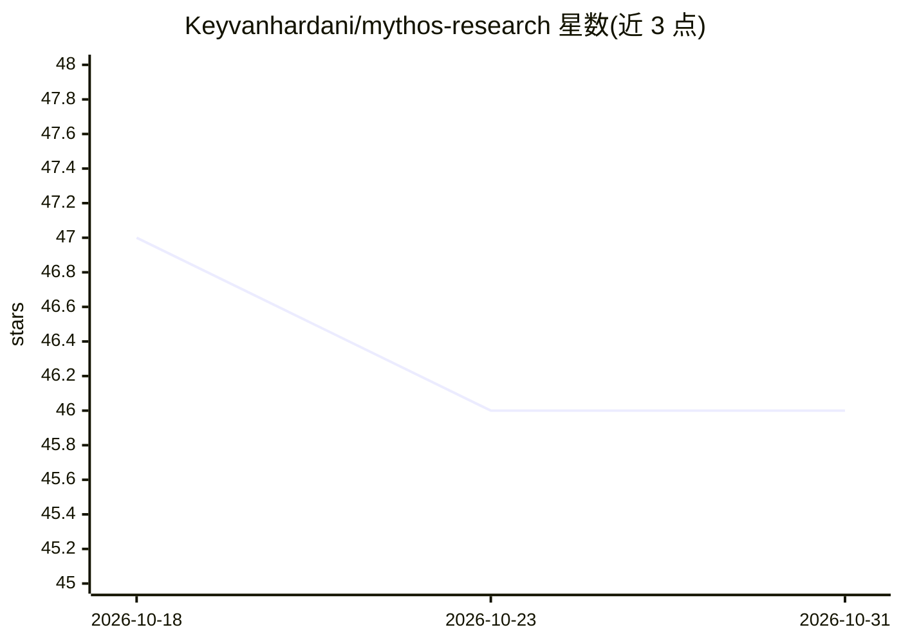

# Keyvanhardani/mythos-research

⭐ 46 · Shell · Apache-2.0 · 推送 2026-05-04 · [GitHub](https://github.com/Keyvanhardani/mythos-research) · [官网](https://doi.org/10.5281/zenodo.19727857) · 个人维护

**开源 agentic 漏洞发现脚手架：复现 Anthropic Mythos/Glasswing**

对 Anthropic Mythos Preview / Project Glasswing 的 outside-in 复现：不含专用模型检查点，发现管线运行在公开的 claude-opus-4-7 上，经 Claude Code CLI 驱动。管线含八个阶段：语言检测、sink 引导切片（ripgrep + 语言专属 sink 目录）、文件分级、构建沙箱、并行 agentic 狩猎、对抗性自质疑等；Phase 5 实弹执行验证保留在私有扩展中未发布。面向 OSS 维护者发布前自扫、安全研究人员授权审计与学术复现，单次定向扫描成本约 $0.30–1.50。不适用于大规模扫描、MSP/MSSP 流程、黑盒/二进制目标。

## 筛选速览

| 维度 | 判定 | 备注 |
|---|---|---|
| AI 角色 | `ai-native` | 本体是模型或模型工具 |
| 许可风险 | `permissive` | Apache-2.0 |
| 部署形态 | `library` | 以包/库形式分发 |
| 模型依赖 | locked-api |  |
| 硬件要求 | — | 无带数字的原话,不猜 |
| 安装摩擦 | `low` | 无编译、无系统依赖或容器化 |
| 成熟度 | — | 结构信号不足 |

## 能力要点

- 八阶段 sink 引导式漏洞发现管线（Phase 0–4/6/7 开源，Phase 5 保留私有）
- 运行于公开 claude-opus-4-7，经 Claude Code CLI 驱动，单次扫描约 $0.30–1.50
- 每个发现经对抗性自质疑（fresh agent 提出最强反驳）做怀疑式验证
- v4 构建沙箱：目标按语言编译（ASan/venv/npm install），hunter 在隔离目录内操作

## 适用场景

- 开源维护者发布前对自身仓库做定向安全自扫
- 学术小组按版本化提示词复现 Mythos 方法论
- 个体研究者开展协调披露（CVD）工作中的漏洞发现阶段

## 场景标签

`网络安全` · 领域:学习与行业

## 证据(README 行号)

> L11: > **An open-source, outside-in replication of Anthropic's Mythos Preview / Project Glasswing — built around the pub
> L35: This repository is an **outside-in replication of the scaffold half** of that programme.
> L39: Claude Code CLI.

## 星数曲线

2026-10-18 47 → 2026-10-31 46（-1）

---
*卡片 v1 · prompt 1.4 · 生成 2026-10-25 · 置信度 mid · 依据 README sha `18f7ac2ebd92` · [字段定义](../../DATASET.md)*
