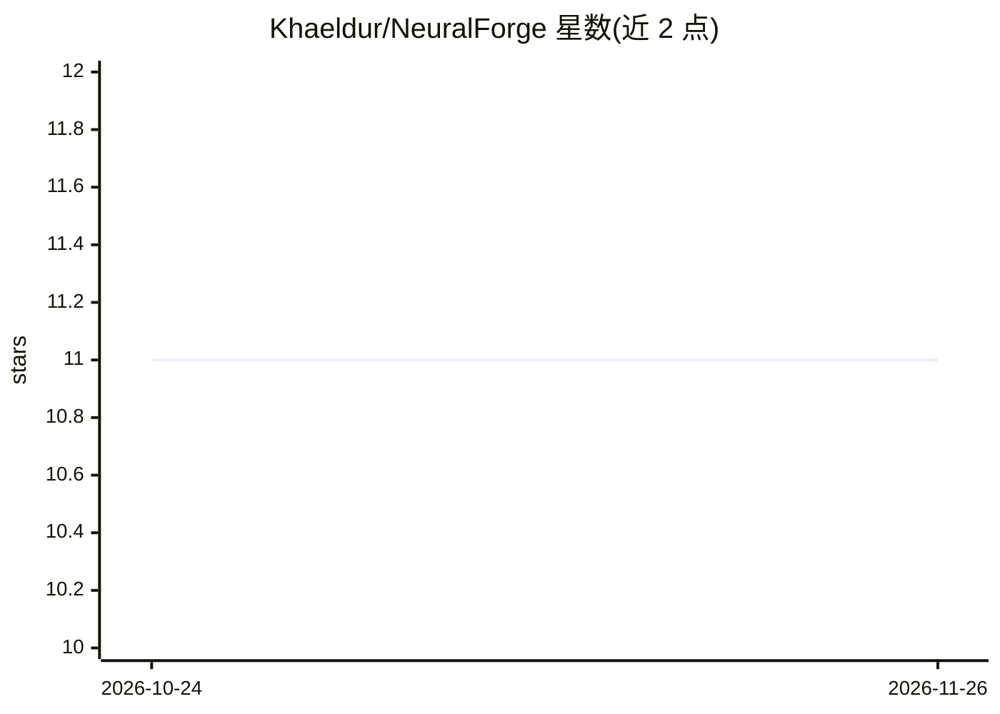

# Khaeldur/NeuralForge

⭐ 11 · Swift · MIT · 推送 2026-03-10 · [GitHub](https://github.com/Khaeldur/NeuralForge) · 个人维护

**在 Apple Silicon 上用神经引擎本地微调 LLM 的 macOS 工具**

由 CLI 训练引擎（C/Obj-C，make 构建）与 SwiftUI macOS 应用组成，通过 NDJSON stdout 协议通信。核心机制：调用 maderix/ANE 逆向的私有 AppleNeuralEngine.framework 直接在神经引擎上执行前向/部分反向计算，Adam 与损失在 CPU；进程接近 ANE 内核编译上限时用 exec() 重启并从检查点续训。提供 LoRA、INT8/INT4 量化、GGUF/CoreML/llama2c 导出、Bonjour 多机分布式训练。需 macOS 14+ Apple Silicon 与 Xcode 15+，从源码构建，默认模型为 110M 参数 LLaMA。

## 筛选速览

| 维度 | 判定 | 备注 |
|---|---|---|
| AI 角色 | `ai-native` | 本体是模型或模型工具 |
| 许可风险 | `permissive` | MIT |
| 部署形态 | `library` | 以包/库形式分发 |
| 模型依赖 | local-ok | 支持本地模型 |
| 硬件要求 | — | 无带数字的原话,不猜 |
| 安装摩擦 | `medium` | 含编译或系统依赖之一 |
| 成熟度 | — | 结构信号不足 |

## 能力要点

- ANE 直接训练：MIL 内核编译、前向/反向在神经引擎执行，exec() 重启绕过约 119 内核编译上限
- LoRA 微调、INT8/INT4 量化、检查点续训与云同步（S3/iCloud）
- 导出 GGUF（llama.cpp）、CoreML、llama2c 三种格式，附 Python 转换器
- Bonjour 多 Mac 集群分布式训练与 CLI/App 共 568 个测试

## 适用场景

- 在 Mac 上用自己的文本数据本地微调小型 LLaMA 架构模型，数据不出设备
- 将微调后模型导出为 GGUF 或 CoreML 供其他运行时部署
- 用多台 Mac 组建小型分布式训练集群

## 场景标签

`微调` `模型量化` · 领域:训练与推理

## 证据(README 行号)

> L5: NeuralForge lets you fine-tune transformer models directly on your Mac using the Apple Neural Engine (ANE). Your dat
> L9: - **On-device training** — Fine-tune LLMs on Apple Silicon using the Neural Engine
> L34: **CLI** handles all heavy lifting: ANE kernel compilation, forward/backward passes, Adam optimizer, checkpointing. 

## 星数曲线

2026-10-24 11 → 2026-11-26 11（+0）

---
*卡片 v1 · prompt 1.4 · 生成 2026-11-19 · 置信度 mid · 依据 README sha `acf116c7b6bc` · [字段定义](../../DATASET.md)*
