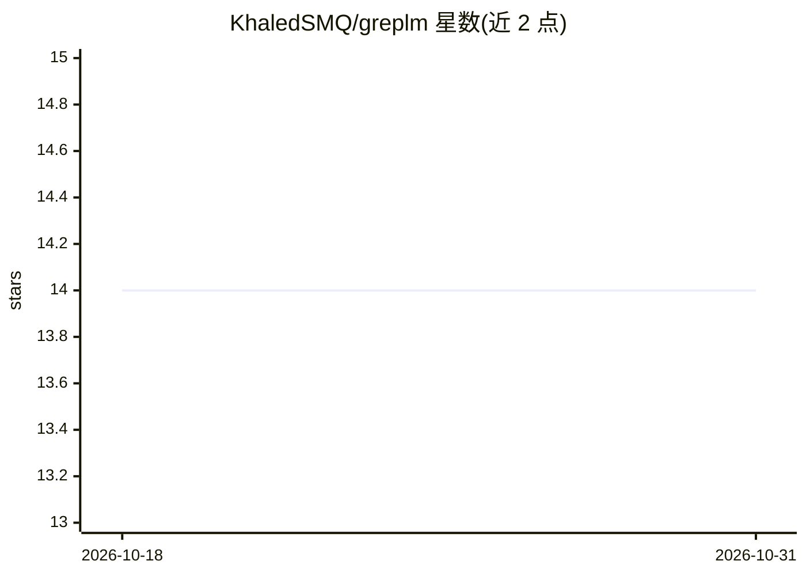

# KhaledSMQ/greplm

⭐ 14 · Rust · MIT · 推送 2026-08-11 · [GitHub](https://github.com/KhaledSMQ/greplm) · [官网](https://greplm.com) · 个人维护

**给 LLM 编码 agent 的本地代码索引与检索工具，省 token**

面向编码 agent 的本地代码搜索与代码智能工具：构建一次持久增量索引，通过 CLI、常驻 daemon 和 MCP server 响应内容搜索、符号定义、引用、调用图、类型化跳转定义、AST 查询、git blame/history 等查询，返回精确行位置而非整个文件正文，宣称相比 grep+整读方式减少约 99% token。支持 14 种语言，完全离线。提供 curl 安装脚本、cargo 安装与预编译二进制；可向 Cursor、Claude Code、Copilot 等编辑器写入配置使其优先使用 greplm。

## 筛选速览

| 维度 | 判定 | 备注 |
|---|---|---|
| AI 角色 | `ai-ecosystem` | LLM/agent 周边工具 |
| 许可风险 | `permissive` | MIT |
| 部署形态 | `library` | 以包/库形式分发 |
| 模型依赖 | — | README 未给出锁定关系 |
| 硬件要求 | — | 无带数字的原话,不猜 |
| 安装摩擦 | `low` | 无编译、无系统依赖或容器化 |
| 成熟度 | — | 结构信号不足 |

## 能力要点

- 持久增量索引 + 常驻 daemon，查询毫秒级返回精确行位置
- 14 种语言的符号、引用、调用图、AST 查询与 git 时间旅行
- 提供 MCP server 与 agent 配置文件写入（CLAUDE.md/AGENTS.md/.cursor/rules）
- 完全离线运行，含 token 节省统计命令 greplm savings

## 适用场景

- 让编码 agent 用索引检索代替 grep+读整文件以节省上下文
- 在 Cursor/Claude Code 等编辑器中接入代码智能查询
- 大型代码库上做调用图、影响面与跳转定义查询

## 场景标签

 · 领域:开发者工具/代码智能

## 证据(README 行号)

> L5: greplm is a hot local index for LLM agents. It answers search, call-graph, go-to-definition,
> L6: AST, and git queries in **milliseconds** and hands back the exact lines that matter — never
> L156: Three commands wire greplm into Cursor, Claude Code, Copilot, and the rest:

## 星数曲线

2026-10-18 14 → 2026-10-31 14（+0）

---
*卡片 v1 · prompt 1.4 · 生成 2026-10-31 · 置信度 high · 依据 README sha `7ff0c7af693e` · [字段定义](../../DATASET.md)*
