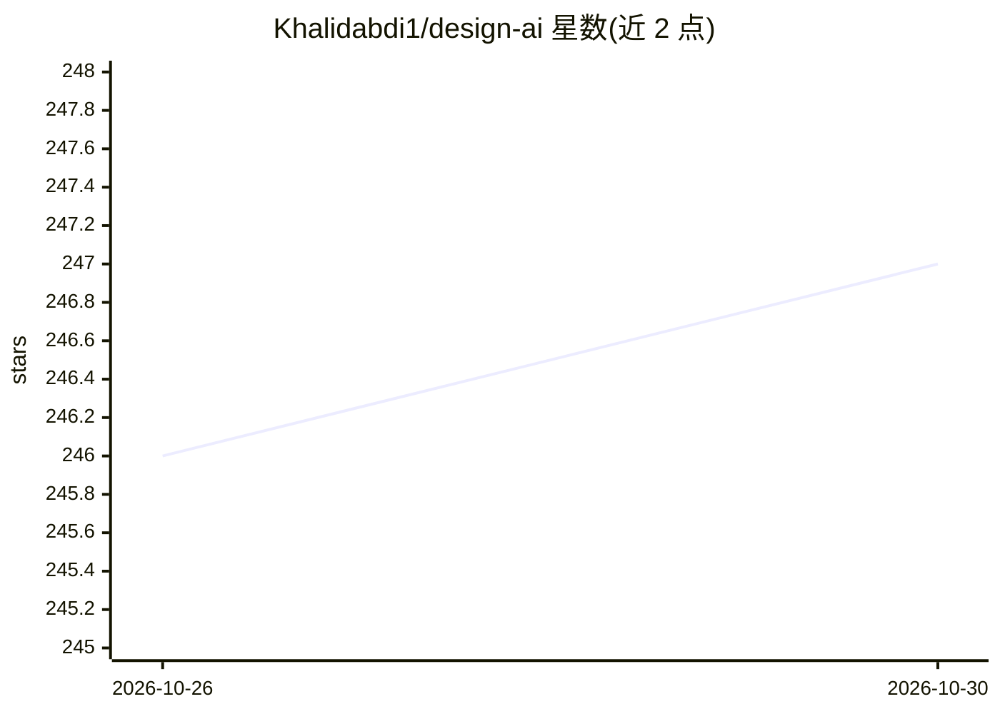

# Khalidabdi1/design-ai

⭐ 247 · MIT · 推送 2026-09-28 · [GitHub](https://github.com/Khalidabdi1/design-ai) · 个人维护

**面向 AI 编码代理的 DESIGN.md 设计系统文件库**

从公开网站提取的 DESIGN.md 文件策展库，覆盖 Apple、Stripe、Figma、Netflix 等 300 余个品牌，按社交、创作、商业、开发工具、金融、AI、企业基础设施等类别组织。每份文件采用统一 9 段格式（视觉主题、色彩语义、排版、组件样式、布局、阴影层级、Do's 与 Don'ts、响应式行为、Agent 提示指南），供 AI 编码/设计代理读取以生成贴近目标设计系统的 UI。使用方式为从 design-md/ 目录复制文件到项目根目录，并在提示中让代理以该文件为设计依据；仓库另含 llms.txt 供 AI 解析，采用 MIT 许可。

## 筛选速览

| 维度 | 判定 | 备注 |
|---|---|---|
| AI 角色 | `ai-knowledge` | 知识聚合/清单类 |
| 许可风险 | `permissive` | MIT |
| 部署形态 | `None` |  |
| 模型依赖 | — | README 未给出锁定关系 |
| 硬件要求 | — | 无带数字的原话,不猜 |
| 安装摩擦 | `low` | 无编译、无系统依赖或容器化 |
| 成熟度 | — | 结构信号不足 |

## 能力要点

- 300+ 品牌的 DESIGN.md 文件，按 10 余个类别组织
- 每份文件统一 9 段结构，含 Agent Prompt Guide 提示片段
- 提供 llms.txt 机器可读项目摘要
- 通过 GitHub issue 可申请新增公司/网站条目

## 适用场景

- 让 AI 编码代理按已知品牌的设计系统生成前端
- 收集结构化的网站设计系统参考用于研究
- 团队以 DESIGN.md 作为可移植的 AI 设计契约做实验

## 场景标签

`精选清单` · 领域:学习与行业

## 证据(README 行号)

> L5: This repository is a curated library of `DESIGN.md` files extracted from real public websites so AI agents can gener
> L21: `Design AI Systems` is a searchable collection of reusable `DESIGN.md` files for popular websites and product brand
> L35: `DESIGN.md` is a plain-text design system document that AI agents can read to generate consistent UI. It is lightwe

## 星数曲线

2026-10-26 246 → 2026-10-30 247（+1）

---
*卡片 v1 · prompt 1.4 · 生成 2026-10-25 · 置信度 high · 依据 README sha `061a47837887` · [字段定义](../../DATASET.md)*
