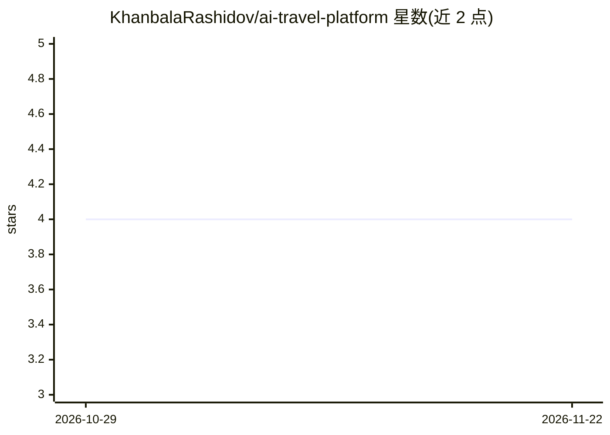

# KhanbalaRashidov/ai-travel-platform

⭐ 4 · Go · MIT · 推送 2026-10-24 · [GitHub](https://github.com/KhanbalaRashidov/ai-travel-platform) · 个人维护

**开源 AI 旅行规划平台：生成多城多国低成本路线与逐日行程**

Go(Fiber)+Next.js 构建的旅行规划平台，仅提供规划与报价，不做预订、支付或签证建议。核心机制：多城/多国最低成本路线优化（Held-Karp 与 NN+2-opt 求解 TSP）、多源抓取价格并经 AI 提取（禁止编造价格/评分的防护栏）、逐日结构化行程与地图标注、酒店/POI/餐饮估算、EN/AZ/RU/TR 多语言界面。LLM 供应商可配置，无 key 时 AI 端点返回 503，其余功能仍可运行。一条 docker compose 命令启动 Postgres+Redis+api+web。

## 筛选速览

| 维度 | 判定 | 备注 |
|---|---|---|
| AI 角色 | `ai-native` | 本体是模型或模型工具 |
| 许可风险 | `permissive` | MIT |
| 部署形态 | `self-host` | docker 或自建部署 |
| 模型依赖 | locked-api |  |
| 硬件要求 | — | 无带数字的原话,不猜 |
| 安装摩擦 | `low` | 无编译、无系统依赖或容器化 |
| 成熟度 | — | 结构信号不足 |

## 能力要点

- 最低成本多城/多国路线优化（TSP 算法：Held-Karp、NN+2-opt）
- 多源真实价格抓取 + AI 提取，带禁止编造数字的防护栏
- 逐日结构化行程：地点按邻近度分组、地图标注、可编辑
- LLM 供应商可切换：Groq（默认）/ Gemini / Claude，无 key 也可运行

## 适用场景

- 规划多城市跨国旅行的最低成本路线
- 按逐日行程浏览景点、酒店与餐饮预算
- 在本地或局域网自托管旅行规划服务

## 场景标签

 · 领域:旅游/行程规划

## 证据(README 行号)

> L5:  Advisory-only, cost-optimal multi-country trip planner.
> L33: - **LLM:** provider-agnostic — **Groq** (default, free) · Gemini · Claude. Runs token-less too (AI endpoints return

## 星数曲线

2026-10-29 4 → 2026-11-22 4（+0）

---
*卡片 v1 · prompt 1.4 · 生成 2026-11-21 · 置信度 mid · 依据 README sha `8c42ab823f1e` · [字段定义](../../DATASET.md)*
