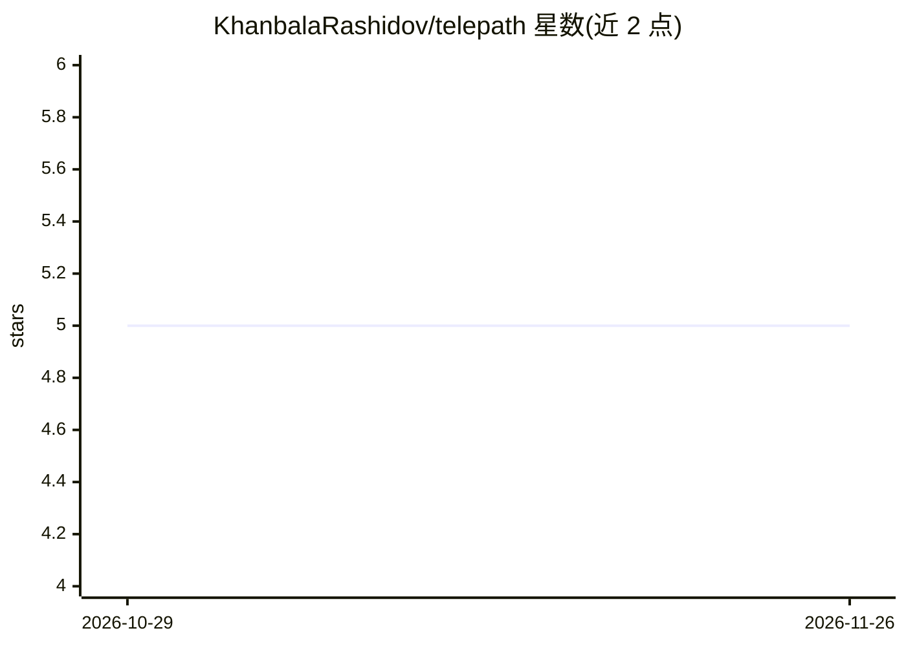

# KhanbalaRashidov/telepath

⭐ 5 · Go · MIT · 推送 2026-10-28 · [GitHub](https://github.com/KhanbalaRashidov/telepath) · 个人维护

**从 Telegram/Slack 远程驱动本机 AI 编码代理的桥接器**

自托管的 Telegram/Slack 与编码代理（Claude Code、Gemini CLI、Codex CLI、Aider）之间的桥接工具，用 Go 编写：用户发消息下达任务，工具在本机项目内运行代理，流式回传输出、diff 与命令，支持在聊天中实时批准/拒绝敏感操作；每个任务在独立 git 分支上执行，永不推送、合并或改动 main。支持 NAT 后长轮询/Socket Mode，代理可按会话切换，权限模式分 auto/allowlist/interactive。

## 筛选速览

| 维度 | 判定 | 备注 |
|---|---|---|
| AI 角色 | `ai-ecosystem` | LLM/agent 周边工具 |
| 许可风险 | `permissive` | MIT |
| 部署形态 | `desktop` | 安装包/桌面程序 |
| 模型依赖 | — | README 未给出锁定关系 |
| 硬件要求 | — | 无带数字的原话,不猜 |
| 安装摩擦 | `low` | 无编译、无系统依赖或容器化 |
| 成熟度 | — | 结构信号不足 |

## 能力要点

- 支持 Telegram 与 Slack 双传输，NAT 后可用长轮询/Socket Mode
- 统一接口驱动 Claude Code、Gemini CLI、Codex CLI、Aider，可按会话切换
- 每任务独立 git 分支，交互式审批经 MCP 权限钩子实现
- 聊天 ID 白名单与超时默认拒绝的安全机制

## 适用场景

- 外出时用手机 Telegram 给本机开发环境派发编码任务
- 在聊天中逐步审批代理的危险操作
- 要求所有变更以可审查分支形式返回，不直接碰主分支

## 场景标签

`编码 Agent` · 领域:编码与开发

## 证据(README 行号)

> L12: Telepath is a self-hosted bridge between **Telegram or Slack** and a coding agent
> L13: (Claude Code, Gemini CLI, OpenAI Codex CLI, or Aider) running on your dev box.
> L22: - 🧩 **Agent-agnostic.** One common interface drives multiple agents; switch per

## 星数曲线

2026-10-29 5 → 2026-11-26 5（+0）

---
*卡片 v1 · prompt 1.4 · 生成 2026-11-21 · 置信度 mid · 依据 README sha `567b69c5937b` · [字段定义](../../DATASET.md)*
