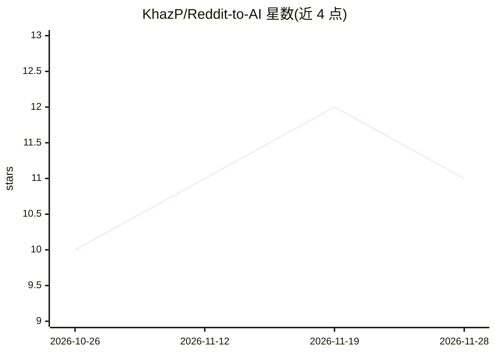

# KhazP/Reddit-to-AI

⭐ 11 · JavaScript · MPL-2.0 · 推送 2026-10-15 · [GitHub](https://github.com/KhazP/Reddit-to-AI) · [官网](https://chromewebstore.google.com/detail/reddit-to-ai/bicbjlpilomgienlbifkjbmkenecelcn) · 个人维护

**浏览器扩展：抓取 Reddit 帖子并送入 AI 聊天界面分析**

Manifest V3 浏览器扩展（Chrome 与 Firefox 121+），抓取 Reddit 帖子（主帖、嵌套评论、图片等媒体），经内容过滤、排序与上下文预算控制后，以预设或自定义提示词模板自动粘贴到所选 AI 聊天界面。发送前可预览和编辑提示词，支持历史记录管理与多线程批量抓取。所有抓取、提示词构建和历史数据留在本地，无后端服务器；可选匿名使用统计可关闭。安装方式为源码加载（Chrome 开发者模式加载 unpacked，Firefox 需 npm 打包）。

## 筛选速览

| 维度 | 判定 | 备注 |
|---|---|---|
| AI 角色 | `ai-enhanced` | 去掉 AI 部分产品仍成立 |
| 许可风险 | `permissive` | MPL-2.0 |
| 部署形态 | `library` | 以包/库形式分发 |
| 模型依赖 | — | README 未给出锁定关系 |
| 硬件要求 | — | 无带数字的原话,不猜 |
| 安装摩擦 | `low` | 无编译、无系统依赖或容器化 |
| 成熟度 | — | 结构信号不足 |

## 能力要点

- 递归评论抓取（可配置深度）与内容过滤/排序（评分、争议度、OP 回复等 7 种裁剪逻辑）
- 上下文预算器：字符/token/评论数/图片数计量与 Small 到 Max Quality 预设
- 内置 5 种提示词模板（摘要、辩论分析、情感分析、ELI5、要点提取），支持 {content} 占位符自定义
- 本地化隐私设计：内容与提示词不离开本地，可选匿名统计可退出

## 适用场景

- 对 Reddit 讨论做情感分析或辩论要点总结
- 快速给长帖生成 TL;DR
- 粘贴多个帖子 URL 做跨线程对比分析

## 场景标签

`网页抓取` `浏览器自动化` · 领域:效率与自动化

## 证据(README 行号)

> L16: **Reddit to AI** is a powerful browser extension (Chrome and Firefox) that bridges the gap between Reddit discussio
> L46:  * **No Remote Server for Your Content**: All scraping, prompt building, and history stay local. Thread content, pr
> L108: * **Runtime**: No backend server required; all extension logic runs locally.

## 星数曲线

2026-10-26 10 → 2026-11-28 11（+1）

---
*卡片 v1 · prompt 1.4 · 生成 2026-11-19 · 置信度 high · 依据 README sha `b42f550b4d4c` · [字段定义](../../DATASET.md)*
