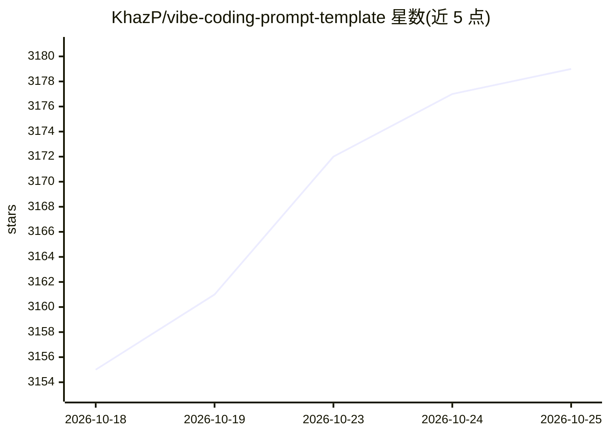

# KhazP/vibe-coding-prompt-template

⭐ 3,185 · TypeScript · MIT · 推送 2026-10-04 · [GitHub](https://github.com/KhazP/vibe-coding-prompt-template) · [官网](https://vibeworkflow.app/) · 个人维护

**用四步提示词模板把想法转为 PRD/技术设计并用 AI 编码助手构建**

面向开发者的 vibe coding 工作流模板库：提供四份自包含提示词，引导用户依次完成想法研究、MVP/PRD 定义、技术设计选型与编码助手配置（生成 AGENTS.md、MEMORY.md 等指令文件），再按最小功能迭代构建。核心机制是 Handoff Context 与 JSON 元数据块在多次对话间传递决策；无 CLI 安装也可用，另附可选技能与 npx vibeworkflow CLI 脚手架，兼容 ChatGPT、Claude、Gemini、Cursor 等工具。

## 筛选速览

| 维度 | 判定 | 备注 |
|---|---|---|
| AI 角色 | `ai-ecosystem` | LLM/agent 周边工具 |
| 许可风险 | `permissive` | MIT |
| 部署形态 | `library` | 以包/库形式分发 |
| 模型依赖 | — | README 未给出锁定关系 |
| 硬件要求 | — | 无带数字的原话,不猜 |
| 安装摩擦 | `low` | 无编译、无系统依赖或容器化 |
| 成熟度 | — | 结构信号不足 |

## 能力要点

- 四步提示词工作流：Research→PRD→Tech Design→编码助手配置
- Handoff Context 与 JSON 元数据块跨对话传递决策
- 生成 AGENTS.md/MEMORY.md/REVIEW-CHECKLIST.md 等项目指令文件
- 可选 npx vibeworkflow CLI 脚手架与 doctor 检查

## 适用场景

- 用 AI 编码助手从零启动一个新项目并获得完整规划文档
- 在不同 AI 工具（ChatGPT/Claude/Gemini/Cursor）间切换继续开发
- 为编码助手生成长期项目指令与进度记忆文件

## 场景标签

`提示工程` · 领域:Agent 开发

## 证据(README 行号)

> L5:  Four complete prompts to turn your idea into a plan, then build it with your AI coding assistant.
> L25: The prompts are deliberately detailed and self-contained. Use ChatGPT, Claude, Gemini, or another chat tool for pla
> L85: - Skills and tool setup — install only the files your assistant uses.

## 星数曲线

2026-10-18 3,155 → 2026-10-25 3,179（+24）

---
*卡片 v1 · prompt 1.4 · 生成 2026-10-20 · 置信度 high · 依据 README sha `fdd249e3ea36` · [字段定义](../../DATASET.md)*
