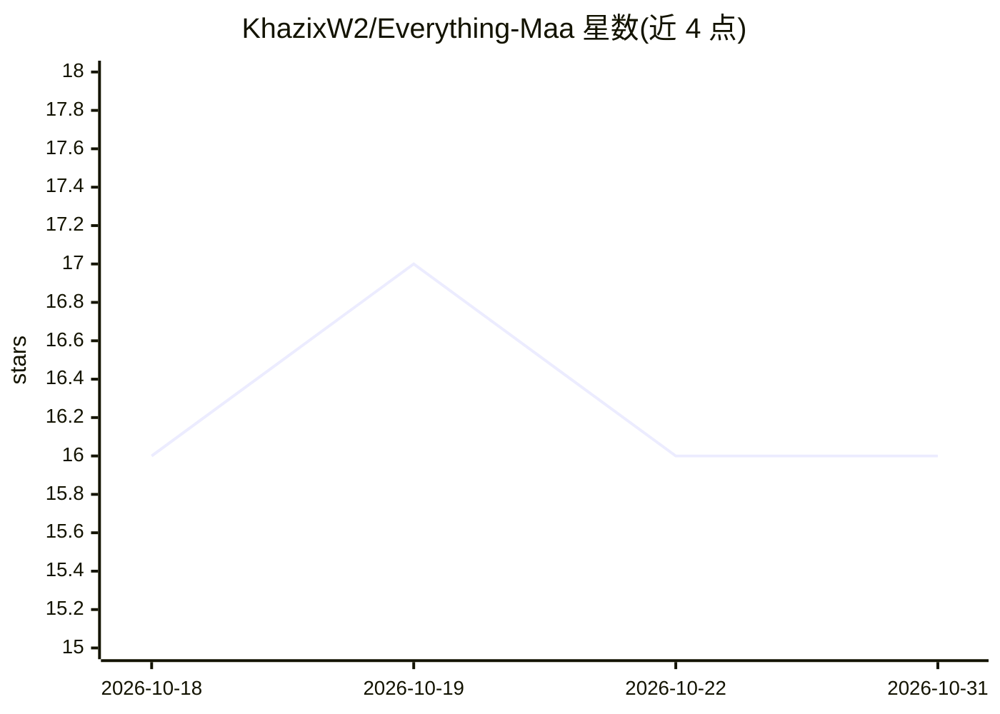

# KhazixW2/Everything-Maa

⭐ 16 · Python · MIT · 推送 2026-10-06 · [GitHub](https://github.com/KhazixW2/Everything-Maa) · 个人维护 · 中文 README

**面向 MaaFramework 项目的可复用 AI 技能包与 MCP 集成工具箱**

为 MaaFramework（安卓/UI 自动化框架）开发场景提供 13 个可复用 AI 技能，覆盖意图到工作流的编排、项目创建与诊断、Project Interface 维护、Pipeline 编写与生成、选项接线、图分析、测试与历史审计等，并配置 MaaMCP 及可选的 create-maa-project、Playwright MCP 集成。通过 npx 安装器按 profile（skills-only/core/authoring/full）装入 Claude Code 或 Codex 目标；卸载按记录哈希精确移除。不内置 MaaFramework 二进制、OCR 模型等上游组件，需 uvx/npx 按需拉取。

## 筛选速览

| 维度 | 判定 | 备注 |
|---|---|---|
| AI 角色 | `ai-ecosystem` | LLM/agent 周边工具 |
| 许可风险 | `permissive` | MIT |
| 部署形态 | `library` | 以包/库形式分发 |
| 模型依赖 | — | README 未给出锁定关系 |
| 硬件要求 | — | 无带数字的原话,不猜 |
| 安装摩擦 | `low` | 无编译、无系统依赖或容器化 |
| 成熟度 | — | 结构信号不足 |

## 能力要点

- 13 个核心技能覆盖 Maa 项目创建、Pipeline 编写/生成/测试/诊断全流程
- 版本化 profile 安装（skills-only/core/authoring/full）并配置 MaaMCP
- 卸载按内容哈希校验，保留本地修改与无关 MCP 条目
- 零依赖 Node.js 安装器，支持 Claude Code 原生插件市场安装

## 适用场景

- 让 Claude Code/Codex 等 agent 辅助编写和调试 MaaFramework Pipeline
- 为已有 Maa 项目生成 basic_info.md 交接文档并诊断失败原因
- 按需接入 MaaMCP 与 create-maa-project 的项目生命周期工具

## 场景标签

`GUI 自动化` `提示工程` · 领域:Agent 开发

## 证据(README 行号)

> L3: Everything Maa is a focused toolkit of reusable AI skills for MaaFramework projects. Its canonical content covers in
> L25: The default `core` profile installs all thirteen skills and configures MaaMCP. Profiles are explicit and versioned:
> L77: - `.claude-plugin/` and `.codex-plugin/`: native plugin manifests.

## 星数曲线

2026-10-18 16 → 2026-10-31 16（+0）

---
*卡片 v1 · prompt 1.4 · 生成 2026-10-30 · 置信度 high · 依据 README sha `4d09afbc7e27` · [字段定义](../../DATASET.md)*
