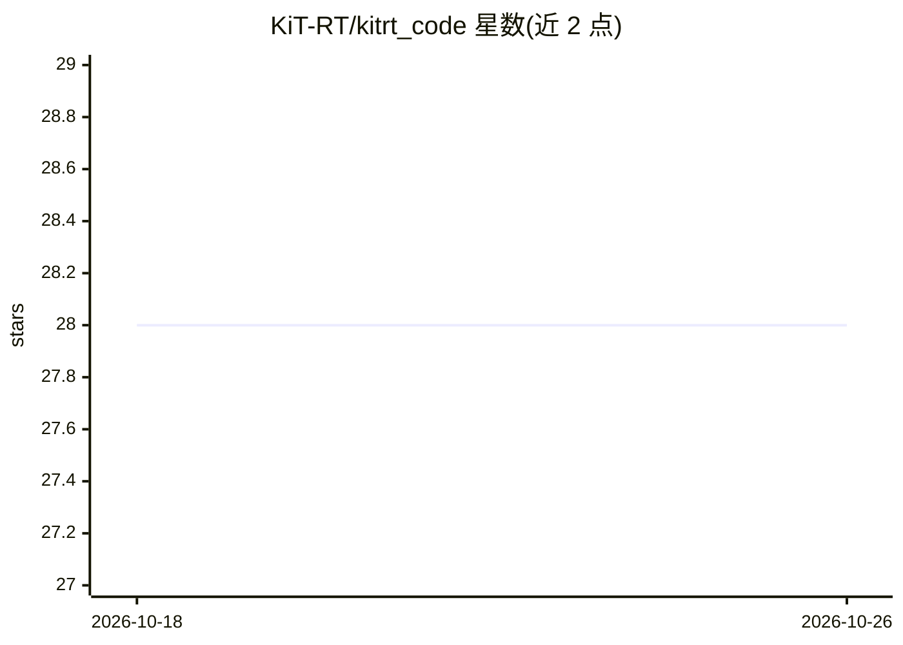

# KiT-RT/kitrt_code

⭐ 28 · C++ · NOASSERTION · 推送 2026-06-05 · [GitHub](https://github.com/KiT-RT/kitrt_code) · [官网](https://kit-rt.readthedocs.io/en/develop/index.html) · 组织维护

**面向 AI 加速科学计算的开源 C++ 辐射输运 PDE 求解器**

KiT-RT 是多保真度 C++ 偏微分方程求解器，用于聚变、裂变与放疗模拟中的辐射输运计算。支持 MPI/OpenMP 分布式并行、CUDA 与 ROCm/HIP GPU 后端、Docker/Singularity/Apptainer 容器化部署，并提供 CharmKiT Python 工作流层用于参数扫描与 SLURM 提交。面向科研与工程团队，应用包括为科学基础模型生成训练数据、为 AI 代理模型提供高分辨率参考解，以及不确定性量化与设计优化等外循环工作流。可选 TensorFlow 后端用于神经网络相关构建。需从源码编译，依赖 C++17、CMake 3.16+、OpenMP、BLAS、LAPACK 与 VTK。

## 筛选速览

| 维度 | 判定 | 备注 |
|---|---|---|
| AI 角色 | `ai-enhanced` | 去掉 AI 部分产品仍成立 |
| 许可风险 | `permissive` | NOASSERTION |
| 部署形态 | `self-host` | docker 或自建部署 |
| 模型依赖 | — | README 未给出锁定关系 |
| 硬件要求 | — | 无带数字的原话,不猜 |
| 安装摩擦 | `low` | 无编译、无系统依赖或容器化 |
| 成熟度 | — | 结构信号不足 |

## 能力要点

- C++ 辐射输运求解器，支持 MPI/OpenMP 分布式并行
- 支持 CUDA 与 ROCm/HIP GPU 后端，无 GPU 时回退 CPU
- Docker/Singularity 容器化部署，配合 CharmKiT Python 工作流层
- 为科学基础模型与 AI 代理模型生成数据及参考解

## 适用场景

- 为科学基础模型生成大规模训练数据集
- 为机器学习代理模型提供高分辨率参考解
- 在 HPC 集群上运行辐射输运模拟并做不确定性量化

## 场景标签

`科研工具` · 领域:学习与行业

## 证据(README 行号)

> L10: KiT-RT is an open-source, multi-fidelity **C++ PDE solver for radiative transport** in fusion, fission, and radiati
> L37: - `kitrt_code`: this C++ solver repository. Use it to build the solver, run one deterministic config, or extend sol
> L177: ### 4. Build with TensorFlow backend (CPU + OpenMP only)

## 星数曲线

2026-10-18 28 → 2026-10-26 28（+0）

---
*卡片 v1 · prompt 1.4 · 生成 2026-10-26 · 置信度 high · 依据 README sha `959446a0f6cb` · [字段定义](../../DATASET.md)*
