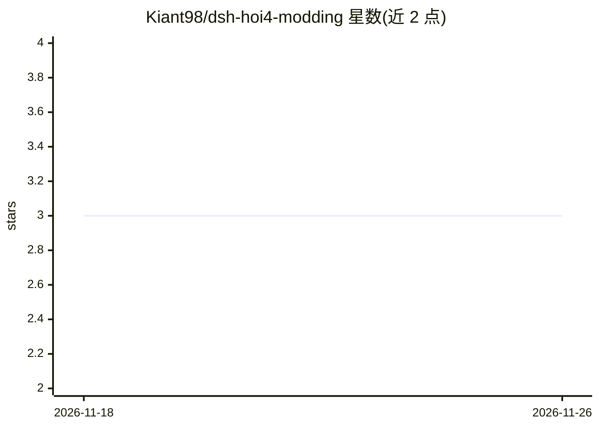

# Kiant98/dsh-hoi4-modding

⭐ 3 · Python · NOASSERTION · 推送 2026-11-13 · [GitHub](https://github.com/Kiant98/dsh-hoi4-modding) · [官网](https://github.com/Kiant98/dsh-hoi4-modding#readme) · 个人维护 · 中文 README

**给 AI agent 用的 HOI4 模组开发工具包：校验、生成、预览**

钢铁雄心4（1.19.x）模组开发工具包，含一个 agent、15 个技能、20 个 MCP 工具和参考库。核心机制：把原版游戏文件索引成 SQLite 知识库，写前查询真实实现，写后用校验器做 12 类机器检查（descriptor、BOM、重复 id、国策树语义等），结果带文件、行号与修改建议；另生成自包含 HTML 离线预览国策树。纯 Python 标准库实现，零第三方依赖，需 Python 3.9+；校验覆盖脚本语言、界面等域，但不覆盖军事相关域。

## 筛选速览

| 维度 | 判定 | 备注 |
|---|---|---|
| AI 角色 | `ai-ecosystem` | LLM/agent 周边工具 |
| 许可风险 | `none` | NOASSERTION |
| 部署形态 | `desktop` | 安装包/桌面程序 |
| 模型依赖 | — | README 未给出锁定关系 |
| 硬件要求 | — | 无带数字的原话,不猜 |
| 安装摩擦 | `low` | 无编译、无系统依赖或容器化 |
| 成熟度 | — | 结构信号不足 |

## 能力要点

- 20 个 MCP 工具：校验、骨架生成、知识库检索、离线预览、规划
- 索引原版游戏文件与官方文档，检索结果带 authority 三级标注
- 12 类校验器输出 file/line/hint，并按是否索引原版做 error/info 降级
- 163 篇参考库，每条结论附出处文件与行号

## 适用场景

- 给 HOI4 模组做进游戏前的静默缺陷检查
- 生成可直接进游戏的国策等内容骨架
- 让 AI agent 按原版实现而非凭记忆写模组文件

## 场景标签

`编码 Agent` `代码生成` · 领域:编码与开发

## 证据(README 行号)

> L11: 钢铁雄心4 的模组开发工具包。一个模组工程师 agent、15 个技能、20 个 MCP 工具，外加一套拿原版游戏当参照物的知识库。
> L251: - 20 个工具自动挂载为 `mcp__kiant_hoi4_modkit__kiant_hoi4_*`，由包内 `lib/index.js` 用本机 `python` 起 `mcp-server/server.py`（stdi
> L277: 接入各客户端见 platform/README.md。

## 星数曲线

2026-11-18 3 → 2026-11-26 3（+0）

---
*卡片 v1 · prompt 1.4 · 生成 2026-11-22 · 置信度 high · 依据 README sha `2b19d9652f76` · [字段定义](../../DATASET.md)*
