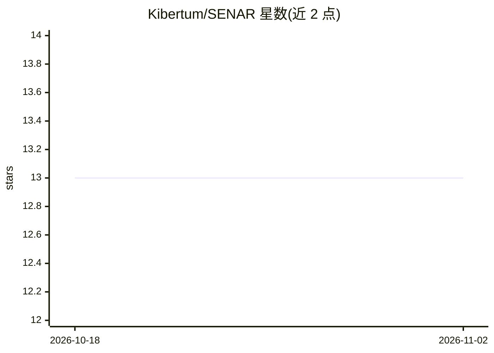

# Kibertum/SENAR

⭐ 13 · JavaScript · CC-BY-SA-4.0 · 推送 2026-09-29 · [GitHub](https://github.com/Kibertum/SENAR) · [官网](https://senar.tech) · 个人维护 · 中文 README

**面向 AI 编码代理协作的开放工程标准：角色、质量门禁与指标**

定义人机协作编码的工程规范文档：包含 15 条具体规则、质量门禁（QG-0 工作前、QG-2 合并前）、以 FPSR（首次通过率）为主要指标，以及 Foundation/Team/Enterprise 三级配置。面向使用 Cursor、Claude Code、Copilot 等 AI 编码工具的团队、CTO 与独立开发者。提供 Markdown/PDF 文档（英俄双语），并引用参考实现 TAUSIK 框架以自动化执行规则；SENAR 本体为文档标准，非可运行软件。

## 筛选速览

| 维度 | 判定 | 备注 |
|---|---|---|
| AI 角色 | `ai-knowledge` | 知识聚合/清单类 |
| 许可风险 | `viral` | CC-BY-SA-4.0 |
| 部署形态 | `None` |  |
| 模型依赖 | — | README 未给出锁定关系 |
| 硬件要求 | — | 无带数字的原话,不猜 |
| 安装摩擦 | `low` | 无编译、无系统依赖或容器化 |
| 成熟度 | — | 结构信号不足 |

## 能力要点

- 15 条具体工程规则与 8 条 SENAR Core 快速规则
- 质量门禁定义（QG-0/QG-2）与 FPSR 首次通过率等指标
- Foundation/Team/Enterprise 三级配置
- 参考实现 TAUSIK 提供 15 项自动检查与 80 个 MCP 工具

## 适用场景

- 为团队引入 AI 编码代理制定工程规范与验收标准
- 搭建带质量门禁的人机协作开发流程
- 评估 AI 辅助开发的效果（FPSR 等指标）

## 场景标签

 · 领域:软件开发工程/标准

## 证据(README 行号)

> L12: SENAR is a practical engineering standard for teams where AI agents write code alongside human engineers. It define
> L33: |**Standard v1.5**|Full specification: roles, rules, quality gates, metrics, conformance|standard/|

## 星数曲线

2026-10-18 13 → 2026-11-02 13（+0）

---
*卡片 v1 · prompt 1.4 · 生成 2026-10-31 · 置信度 high · 依据 README sha `3b53b5df44a2` · [字段定义](../../DATASET.md)*
