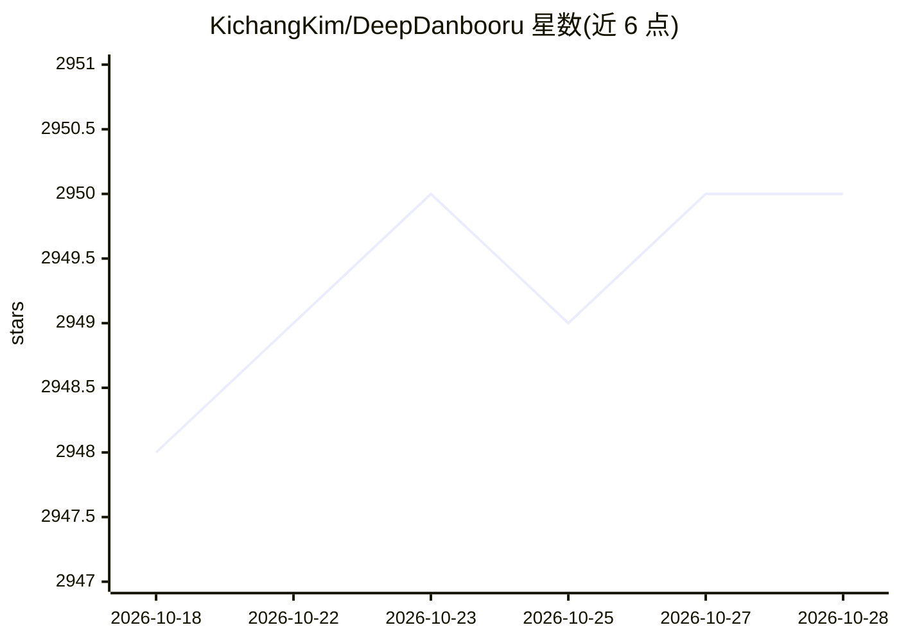

# KichangKim/DeepDanbooru

⭐ 2,950 · Python · MIT · 推送 2026-07-04 · [GitHub](https://github.com/KichangKim/DeepDanbooru) · 个人维护

**基于 TensorFlow 的动漫少女图像多标签识别系统**

Python 实现的动漫风格图像标签估计系统，基于 TensorFlow（>=2.17.0）训练模型并对图像输出多标签分类结果。以 CLI 方式使用：创建训练项目、从 Danbooru 服务器下载标签列表（需账号与 API key）、基于 SQLite 数据库与图像目录组织的自有数据集进行训练，再用 evaluate 命令估计单张或文件夹内图像的标签。默认 pip 安装不含 TensorFlow，需通过 [tensorflow] extra 安装；作者另提供在线演示站点。

## 筛选速览

| 维度 | 判定 | 备注 |
|---|---|---|
| AI 角色 | `ai-native` | 本体是模型或模型工具 |
| 许可风险 | `permissive` | MIT |
| 部署形态 | `library` | 以包/库形式分发 |
| 模型依赖 | — | README 未给出锁定关系 |
| 硬件要求 | — | 无带数字的原话,不猜 |
| 安装摩擦 | `low` | 无编译、无系统依赖或容器化 |
| 成熟度 | — | 结构信号不足 |

## 能力要点

- CLI 全流程：create-project / download-tags / train-project / evaluate
- 支持从 Danbooru 服务器拉取最新标签列表（需账号与 API key）
- 数据集以 SQLite posts 表 + 按文件名前两字符分目录的图像组织
- 提供在线演示站点 DeepDanbooru Web

## 适用场景

- 给动漫少女图像自动估计 danbooru 风格标签
- 用自有数据集训练自定义标签分类模型
- 批量评估文件夹内图像的标签

## 场景标签

`目标检测` · 领域:感知与多模态

## 证据(README 行号)

> L6: **DeepDanbooru** is anime-style girl image tag estimation system. You can estimate your images on my live demo site,
> L9: DeepDanbooru is written by Python 3.11. Following packages are need to be installed.

## 星数曲线

2026-10-18 2,948 → 2026-10-28 2,950（+2）

---
*卡片 v1 · prompt 1.4 · 生成 2026-10-21 · 置信度 high · 依据 README sha `4d33969e52a9` · [字段定义](../../DATASET.md)*
