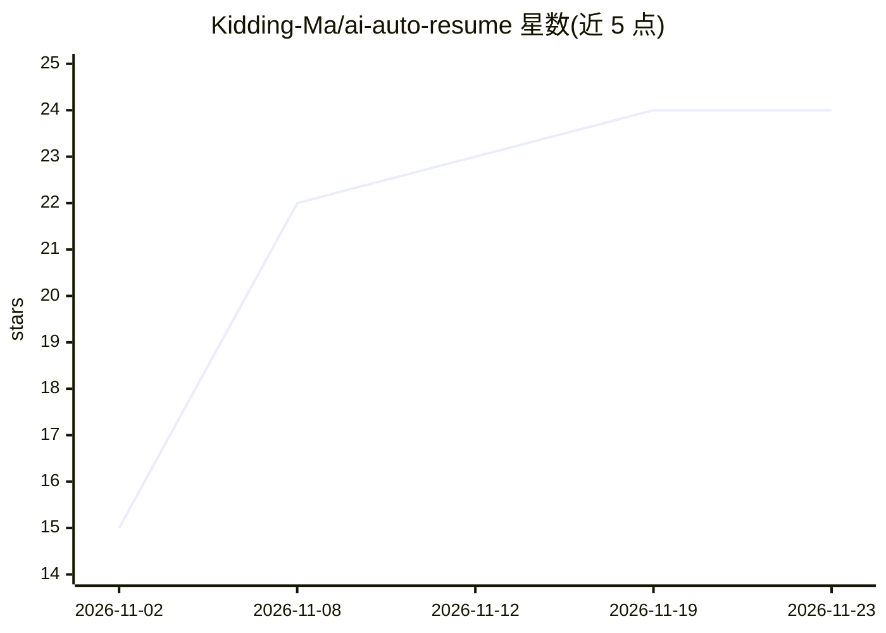

# Kidding-Ma/ai-auto-resume

⭐ 24 · Python · MIT · 推送 2026-11-05 · [GitHub](https://github.com/Kidding-Ma/ai-auto-resume) · 个人维护 · 中文 README

**面向求职者，用 AI 一句话生成 LaTeX 简历 PDF**

提供一套 AI 驱动的简历生成工作流：用户将旧简历、项目资料或个人情况文本放入工作文件夹，向能读取本地文件、运行命令的 AI 助手发送固定提示词，AI 按 README 指向的 AGENTS.md 规则与内置模板整理材料、排版并生成 PDF 与可编辑源文件至 output/ 目录。采用 Overleaf 中文简历模板与 LaTeX 排版，内置 resume-project-miner，参考 Reactive Resume、ResumeSkills 的写作方法。MIT 许可，支持中英双语使用。

## 筛选速览

| 维度 | 判定 | 备注 |
|---|---|---|
| AI 角色 | `ai-native` | 本体是模型或模型工具 |
| 许可风险 | `permissive` | MIT |
| 部署形态 | `None` |  |
| 模型依赖 | — | README 未给出锁定关系 |
| 硬件要求 | — | 无带数字的原话,不猜 |
| 安装摩擦 | `low` | 无编译、无系统依赖或容器化 |
| 成熟度 | — | 结构信号不足 |

## 能力要点

- 一句提示词生成 PDF 简历，输出可编辑 LaTeX 源文件
- 支持旧简历、照片、招聘要求等多种材料直接放入工作区
- 采用 Overleaf 中文简历模板，无需用户会写 LaTeX
- 通过迭代指令调整（如压缩到一页、按招聘要求修改）

## 适用场景

- 从旧简历和个人资料自动整理生成中文简历 PDF
- 根据具体招聘要求定向修改简历内容
- 没有 LaTeX 经验的求职者排版专业简历

## 场景标签

`AI 写作` · 领域:内容生成

## 证据(README 行号)

> L4:  只要一句提示词，就能生成高质量简历。
> L37: 请按 https://github.com/Kidding-Ma/ai-auto-resume 的最新 AGENTS.md，用当前文件夹里的材料和固定模板生成 PDF 简历；已有工具直接用，不编造经历和数据。
> L42: 推荐 **VS Code + Codex**。OpenCode、DeepSeek Harness 等能读取本地文件、运行命令的助手也可以，无需另外安装 skill 或 agent。

## 星数曲线

2026-11-02 15 → 2026-11-23 24（+9）

---
*卡片 v1 · prompt 1.4 · 生成 2026-11-18 · 置信度 high · 依据 README sha `99c65d9d1d1f` · [字段定义](../../DATASET.md)*
