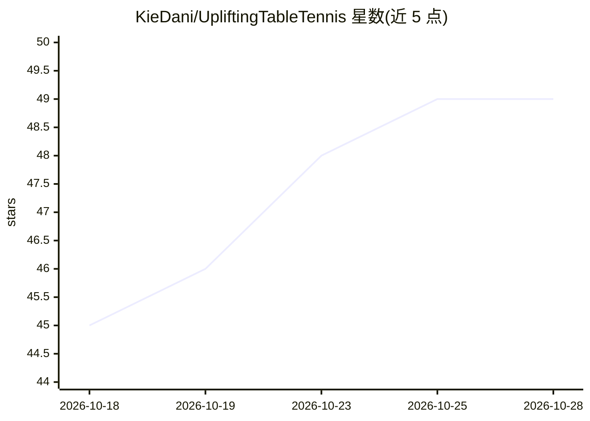

# KieDani/UpliftingTableTennis

⭐ 49 · Python · GPL-3.0 · 推送 2026-02-06 · [GitHub](https://github.com/KieDani/UpliftingTableTennis) · [官网](https://kiedani.github.io/WACV2026/) · 组织维护

**乒乓球 3D 轨迹与旋转估计的论文官方实现**

WACV 2026 论文 Uplifting Table Tennis 的官方代码：从单目视频出发的完整流水线，包含球检测（SegFormer++/WASB/VitPose 等模型）、球台关键点检测与相机标定、以及 2D-to-3D uplifting 模型，输出球的 3D 轨迹与旋转估计。模型经 torch.hub 加载，提供 TTHQ/TTST/Blurball 数据集处理脚本与基于 MuJoCo 的合成数据生成，支持推理评估与训练复现。Python 3.12.4、PyTorch 2.6.0 环境下安装；完整安装涉及 mmcv（依赖 VitPose 时）。

## 筛选速览

| 维度 | 判定 | 备注 |
|---|---|---|
| AI 角色 | `ai-native` | 本体是模型或模型工具 |
| 许可风险 | `viral` | GPL-3.0 |
| 部署形态 | `desktop` | 安装包/桌面程序 |
| 模型依赖 | — | README 未给出锁定关系 |
| 硬件要求 | — | 无带数字的原话,不猜 |
| 安装摩擦 | `medium` | 含编译或系统依赖之一 |
| 成熟度 | — | 结构信号不足 |

## 能力要点

- 完整流水线：球检测+球台关键点检测与相机标定+2D-to-3D uplifting
- 训练好的模型经 torch.hub 加载，可单独使用各组件
- 发布论文构建的 TTHQ 数据集并提供处理脚本
- 基于 MuJoCo 的物理仿真合成数据生成（可下载现成版本）

## 适用场景

- 从乒乓球单目视频估计球的 3D 轨迹与旋转
- 复现论文的评估与训练结果
- 在 TTHQ/TTST/Blurball 数据集上做检测与轨迹基准测试

## 场景标签

`图像视频处理` `目标检测` `模型评测` · 领域:评测与运维

## 证据(README 行号)

> L1: # Official Implementation of "Uplifting Table Tennis: A Robust, Real-World Application for 3D Trajectory and Spin Es
> L9: In this section, we explain how to load our trained models via torch.hub.
> L83: For the training of the 2D-to-3D uplifting model, we created a synthetic (but physically accurate) dataset using Mu

## 星数曲线

2026-10-18 45 → 2026-10-28 49（+4）

---
*卡片 v1 · prompt 1.4 · 生成 2026-10-25 · 置信度 high · 依据 README sha `aee7a3084859` · [字段定义](../../DATASET.md)*
