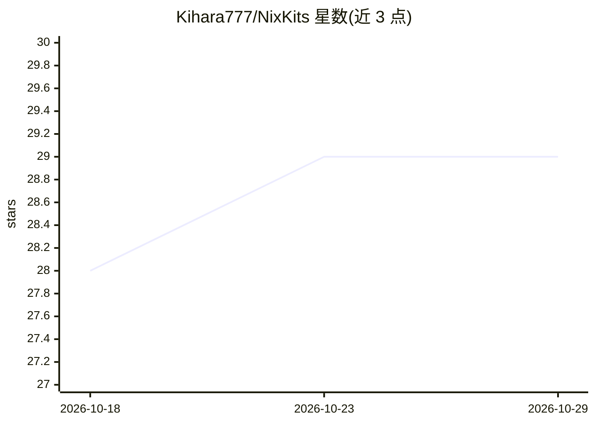

# Kihara777/NixKits

⭐ 29 · Nix · MIT · 推送 2026-10-26 · [GitHub](https://github.com/Kihara777/NixKits) · 个人维护 · 中文 README

**Nix 打包合集：软件、补丁、NixOS 模块与 AI 编码助手技能**

以 Nix flake 形式分发的合集：收录 9 个软件包（含 Blender/Godot 的 MCP Server、DeepSeek 终端编码代理 codewhale、逆向工程 CLI rea 等）、DSH 插件与 Agent 预设模式、ASUS 设备与 ComfyUI ROCm 等 overlay 补丁，以及十余个供 AI 编码助手使用的中文 SKILL.md 技能（Nix 打包、上游审计、Agent 自我维护等）。通过 flake input 或 nix develop 使用，附带二进制缓存。技能面向中文用户与中国开源模型；Claude Code 已从技能安装目标中移除（因国籍判断逻辑）。

## 筛选速览

| 维度 | 判定 | 备注 |
|---|---|---|
| AI 角色 | `ai-ecosystem` | LLM/agent 周边工具 |
| 许可风险 | `permissive` | MIT |
| 部署形态 | `None` |  |
| 模型依赖 | locked-api |  |
| 硬件要求 | — | 无带数字的原话,不猜 |
| 安装摩擦 | `low` | 无编译、无系统依赖或容器化 |
| 成熟度 | — | 结构信号不足 |

## 能力要点

- 9 个软件包含 MCP Server 与终端编码代理
- DSH 插件与 3 种 Agent 预设模式（NixOS/狐莉/新闻三要素）
- overlay 补丁覆盖 asusctl、ComfyUI ROCm、Plasma 主题等
- 十余个中文 SKILL.md 技能，含通用 Nix 打包与上游审计流程

## 适用场景

- 用 Nix 声明式安装 MCP Server 与编码代理等工具
- 为 DeepSeek Harness 配置 NixOS 场景插件与 Agent 预设
- 给 AI 编码助手挂载 Nix 打包与维护类中文技能
- 修补 NixOS 上游包（asusctl、ComfyUI ROCm）获得设备体验修正

## 场景标签

 · 领域:开发工具/NixOS 生态

## 证据(README 行号)

> L7: NixKits — 软件、补丁、NixOS 模块与 AI 编码助手的技能合集。
> L88: 供 AI 编码助手使用的技能：

## 星数曲线

2026-10-18 28 → 2026-10-29 29（+1）

---
*卡片 v1 · prompt 1.4 · 生成 2026-10-26 · 置信度 high · 依据 README sha `f9e0b6292ad9` · [字段定义](../../DATASET.md)*
