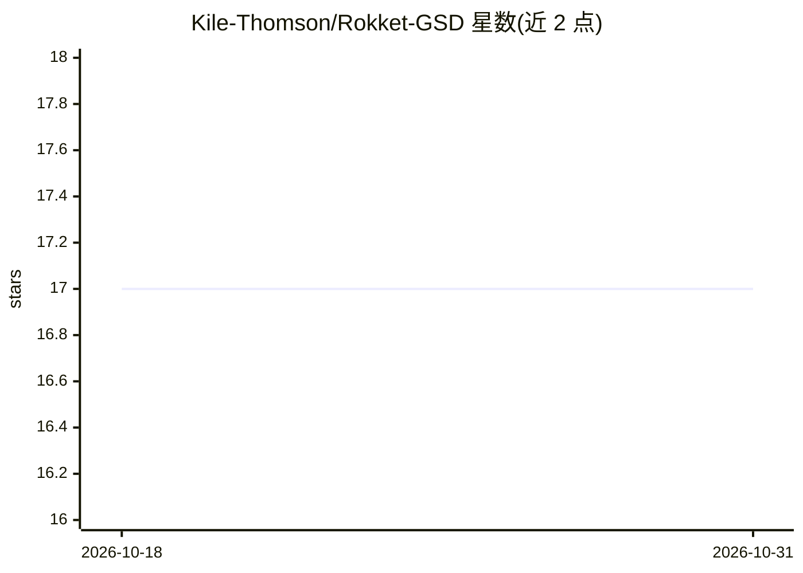

# Kile-Thomson/Rokket-GSD

⭐ 17 · TypeScript · MIT · 推送 2026-09-18 · [GitHub](https://github.com/Kile-Thomson/Rokket-GSD) · 个人维护

**GSD Pi AI 编程代理的 VS Code 图形前端**

面向开发者的 VS Code 扩展，为 GSD Pi（OpenGSD）CLI 编程代理提供原生编辑器界面：通过 JSON-RPC 以子进程方式启动 gsd，提供流式对话、40+ 工具可视化、并行 worker 仪表盘、模型选择与思考级别控制、59+ 斜杠命令、Telegram 远程遥控（含语音转录）。本扩展不包含代理本体，需先全局安装 gsd-pi 并配置至少一个 AI 提供商；兼容 GSD V2，主要开发面向 GSD Pi 分支。提供 VS Code Marketplace、curl/PowerShell 一键脚本与手动 vsce 打包三种安装方式。

## 筛选速览

| 维度 | 判定 | 备注 |
|---|---|---|
| AI 角色 | `ai-ecosystem` | LLM/agent 周边工具 |
| 许可风险 | `permissive` | MIT |
| 部署形态 | `library` | 以包/库形式分发 |
| 模型依赖 | — | README 未给出锁定关系 |
| 硬件要求 | — | 无带数字的原话,不猜 |
| 安装摩擦 | `low` | 无编译、无系统依赖或容器化 |
| 成熟度 | — | 结构信号不足 |

## 能力要点

- 以 JSON-RPC 子进程方式运行 gsd 代理并渲染流式响应
- 59+ 斜杠命令覆盖 GSD 工作流（46 条 GSD 命令 + 13 条内置命令）
- Telegram 中继远程控制，支持 OpenAI/Azure/xAI 语音转录
- 并行 worker 仪表盘、预算告警与会话历史恢复

## 适用场景

- 在 VS Code 内以图形界面驱动 GSD Pi 编程代理
- 通过 Telegram 从手机遥控代理并发送语音指令
- 管理多会话、多 worker 的长时间编码任务

## 场景标签

`编码 Agent` · 领域:编码与开发

## 证据(README 行号)

> L10:  A full-featured VS Code frontend for the GSD Pi AI coding agent.
> L27: The extension spawns GSD as a child process over JSON-RPC (`gsd --mode rpc`), giving the agent full access to your 

## 星数曲线

2026-10-18 17 → 2026-10-31 17（+0）

---
*卡片 v1 · prompt 1.4 · 生成 2026-10-30 · 置信度 high · 依据 README sha `1ceb01aceb34` · [字段定义](../../DATASET.md)*
