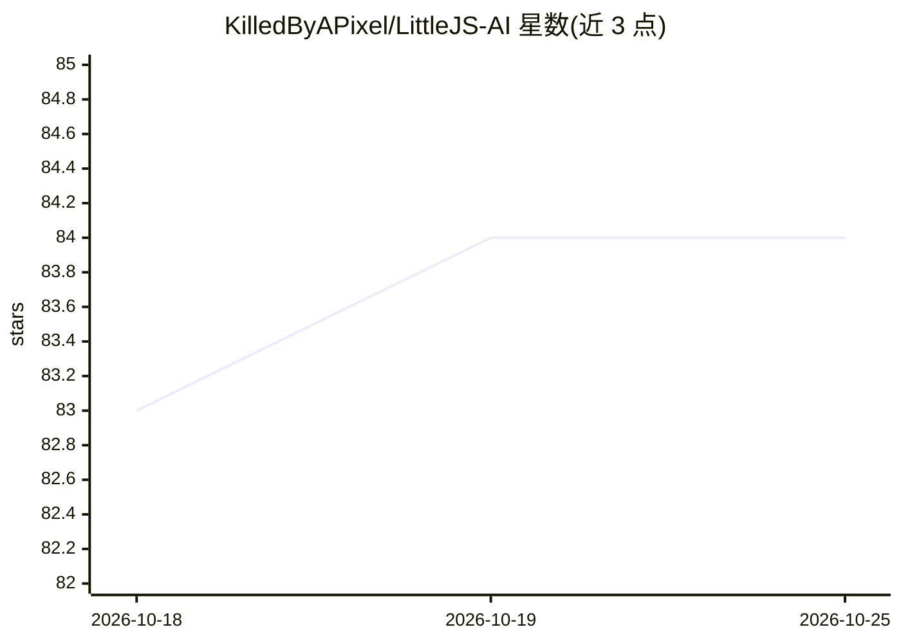

# KilledByAPixel/LittleJS-AI

⭐ 84 · JavaScript · MIT · 推送 2026-10-14 · [GitHub](https://github.com/KilledByAPixel/LittleJS-AI) · 个人维护

**AI 辅助的 LittleJS HTML5 游戏开发工具包：模板+助手模块+agent 指令与 Claude Code 插件**

围绕 LittleJS 开源 HTML5 引擎的 AI 辅助开发工具包：提供可复制的起始模板、菜单/音效/精灵等辅助模块，以及面向编码 AI 的指令文档；以 Claude Code 插件形式分发，内置 5 个技能（引擎规范、项目脚手架、API 查询、形状美术、关卡编辑器），并声明适配 GitHub Copilot、Codex、Cursor。游戏通过纯 script 标签加载全局 API，可从 file:// 直接运行，无服务器与依赖；可用单文件 build.mjs 构建打包。50+ 成品游戏存于 LittleJS Arcade 仓库。

## 筛选速览

| 维度 | 判定 | 备注 |
|---|---|---|
| AI 角色 | `ai-ecosystem` | LLM/agent 周边工具 |
| 许可风险 | `permissive` | MIT |
| 部署形态 | `library` | 以包/库形式分发 |
| 模型依赖 | locked-api |  |
| 硬件要求 | — | 无带数字的原话,不猜 |
| 安装摩擦 | `low` | 无编译、无系统依赖或容器化 |
| 成熟度 | — | 结构信号不足 |

## 能力要点

- Claude Code 插件内置 5 个技能：脚手架/API 查询/引擎规范/美术/关卡编辑
- 起始模板与菜单、程序化音效、精灵生成等辅助模块
- 游戏从 file:// 直接运行，无服务器与外部依赖
- 单文件构建脚本（build.mjs）产出自包含 index.html 与 zip

## 适用场景

- 用 Claude Code 等编码 AI 直接生成可玩的 HTML5 游戏
- 从模板和辅助模块快速搭建游戏原型或参与 game jam
- 浏览 LittleJS Arcade 中 50+ 成品并 fork 作为起点

## 场景标签

`代码生成` · 领域:编码与开发

## 证据(README 行号)

> L3: *An AI-assisted toolkit for making HTML5 games with LittleJS — starter templates, helper modules, agent instructions
> L29: The plugin ships five skills:
> L43: For other tools, LittleJS also works great with GitHub Copilot, Codex, and Cursor.

## 星数曲线

2026-10-18 83 → 2026-10-25 84（+1）

---
*卡片 v1 · prompt 1.4 · 生成 2026-10-24 · 置信度 mid · 依据 README sha `387e0e2ce915` · [字段定义](../../DATASET.md)*
