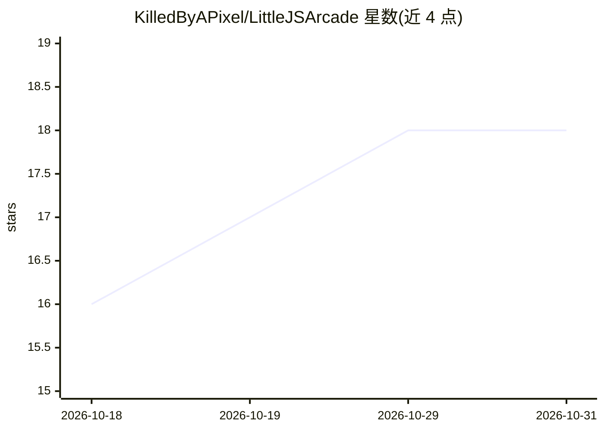

# KilledByAPixel/LittleJSArcade

⭐ 18 · HTML · MIT · 推送 2026-10-15 · [GitHub](https://github.com/KilledByAPixel/LittleJSArcade) · [官网](https://killedbyapixel.github.io/LittleJSArcade/) · 个人维护

**基于 LittleJS 引擎的经典街机游戏合集，浏览器即开即玩**

LittleJS 引擎作者维护的街机游戏集合：射击、解谜、棋牌、赛车、物理玩具等多类游戏，每个游戏为单文件、开源可 fork，浏览器内直接运行，无需安装。街机站提供分类浏览与搜索、Top Picks、吸引模式演示、手柄支持、全屏、分享链接、高分保存，兼容桌面与移动端。仓库含游戏源码文件夹与起始模板；资源区列出 LittleJS AI Tools 与 LittleJS GPT（在 ChatGPT 中生成游戏的工具），仓库主体本身不依赖 AI 功能。除 Twemoji 字体（CC-BY 4.0）外均为 MIT 许可。

## 筛选速览

| 维度 | 判定 | 备注 |
|---|---|---|
| AI 角色 | `ai-enhanced` | 去掉 AI 部分产品仍成立 |
| 许可风险 | `permissive` | MIT |
| 部署形态 | `None` |  |
| 模型依赖 | — | README 未给出锁定关系 |
| 硬件要求 | — | 无带数字的原话,不猜 |
| 安装摩擦 | `low` | 无编译、无系统依赖或容器化 |
| 成熟度 | — | 结构信号不足 |

## 能力要点

- 每个游戏为单文件、浏览器即开即玩且开源可 fork
- 街机站支持分类搜索、手柄、全屏、分享链接与高分保存
- 提供游戏源码文件夹与起始模板、可复用组件

## 适用场景

- 在浏览器中直接游玩多类经典街机风格小游戏
- fork 现成游戏作为自己游戏开发的起点
- 浏览 LittleJS 引擎能力的示例集合

## 场景标签

 · 领域:游戏/网页游戏

## 证据(README 行号)

> L34: - LittleJS AI Tools — templates and skills to improve LittleJS + AI workflows
> L35: - LittleJS GPT — make games in ChatGPT without writing any code

## 星数曲线

2026-10-18 16 → 2026-10-31 18（+2）

---
*卡片 v1 · prompt 1.4 · 生成 2026-10-29 · 置信度 low · 依据 README sha `679d9d9cc94d` · [字段定义](../../DATASET.md)*
