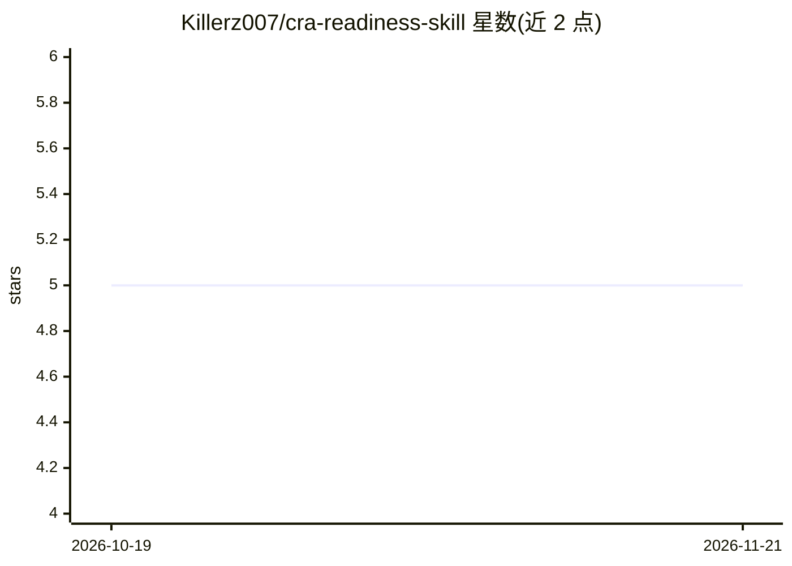

# Killerz007/cra-readiness-skill

⭐ 5 · HTML · Apache-2.0 · 推送 2026-11-02 · [GitHub](https://github.com/Killerz007/cra-readiness-skill) · 个人维护

**面向制造商的欧盟 CRA 法规就绪评估 agent 技能包**

以 SKILL.md 形式交付的 agent 中立技能：将欧盟《网络弹性法案》官方文本（固定哈希版本）转为 96 条可评估条款目录，指导 AI coding agent 对真实代码库执行范围界定、产品分类、网络安全风险评估、SBOM 校验（CycloneDX/SPDX）、Article 14 报告就绪测试与技术文档草稿生成，输出 Markdown/DOCX/PDF 报告。附 Python 脚本做文本同步、哈希校验、期限计算与回归比较。明确声明不构成合规评定或法律意见。

## 筛选速览

| 维度 | 判定 | 备注 |
|---|---|---|
| AI 角色 | `ai-knowledge` | 知识聚合/清单类 |
| 许可风险 | `permissive` | Apache-2.0 |
| 部署形态 | `None` |  |
| 模型依赖 | — | README 未给出锁定关系 |
| 硬件要求 | — | 无带数字的原话,不猜 |
| 安装摩擦 | `low` | 无编译、无系统依赖或容器化 |
| 成熟度 | — | 结构信号不足 |

## 能力要点

- 固定版本并哈希的官方法规文本与 96 条条款机器可读目录
- CycloneDX/SPDX SBOM 校验并与 lockfile 对账
- Article 14 报告 24/72 小时与最终期限计算，支持桌面演练
- 按 Claude Code、Codex、Cursor、Copilot 等各 agent 的目录约定分别给出安装位置

## 适用场景

- 对计划进入欧盟市场的软硬件产品做 CRA 就绪差距评估
- 为技术文档与符合性声明准备草稿材料
- 变更集是否构成实质修改的四要素筛查
- 组织 Article 14 漏洞报告流程演练

## 场景标签

 · 领域:合规/网络安全

## 证据(README 行号)

> L3: An open-source, agent-neutral skill that takes a software or hardware product through an evidence-backed readiness a
> L13: - Pins the Official Journal text of the CRA, Implementing Regulation (EU) 2025/2392 (technical descriptions of impo

## 星数曲线

2026-10-19 5 → 2026-11-21 5（+0）

---
*卡片 v1 · prompt 1.4 · 生成 2026-11-21 · 置信度 mid · 依据 README sha `fd38cdf6cc1d` · [字段定义](../../DATASET.md)*
