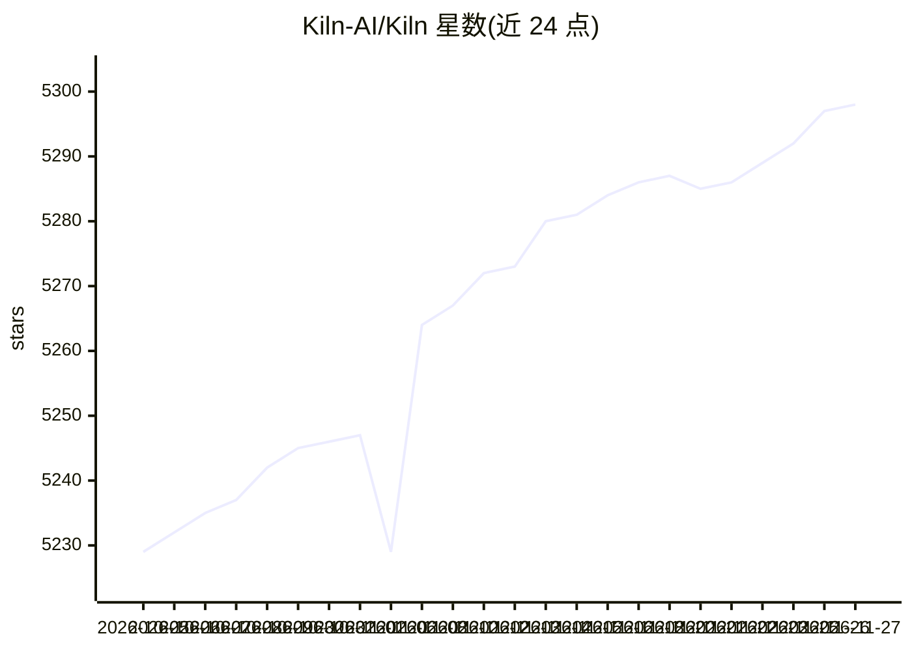

# Kiln-AI/Kiln

⭐ 5,298 · Python · NOASSERTION · 推送 2026-11-26 · [GitHub](https://github.com/Kiln-AI/Kiln) · [官网](https://kiln.tech) · 组织维护

**AI 开发全流程工作台：评测、RAG、微调、合成数据一站式**

覆盖 AI 开发完整循环的桌面应用加 Python 库：评测构建（自动生成 judge 与评测数据集）、RAG（拖拽文档导入并自动生成评测）、多层级子代理编排、零代码微调（60+ 模型，部署于 Fireworks/Together/Vertex）、合成数据生成与数据集管理。内置 MCP server，可从 Claude Code/Codex/OpenCode 等 agent 调用。本地运行，自带 API key 或用 Ollama 完全离线。桌面应用供非技术人员协作打分，MIT 协议的 Python 库负责生产部署；桌面应用为 fair-code 模式的 source-available。

## 筛选速览

| 维度 | 判定 | 备注 |
|---|---|---|
| AI 角色 | `ai-ecosystem` | LLM/agent 周边工具 |
| 许可风险 | `none` | NOASSERTION |
| 部署形态 | `library` | 以包/库形式分发 |
| 模型依赖 | local-ok | 支持本地模型 |
| 硬件要求 | — | 无带数字的原话,不猜 |
| 安装摩擦 | `low` | 无编译、无系统依赖或容器化 |
| 成熟度 | — | 结构信号不足 |

## 能力要点

- Eval Builder 自动生成评测并对齐偏好
- 拖拽文档创建 RAG 并自动生成 RAG 评测
- 零代码微调 60+ 模型（Fireworks/Together/Vertex）
- 内置 MCP server，可被外部 agent 连接操作

## 适用场景

- 团队协作标注数据、给模型输出打分并追踪质量回归
- 为微调和评测快速生成合成数据
- 用自有文档搭建带评测的 RAG
- 在应用中构建 agent 后通过 Python 库部署到生产

## 场景标签

`模型评测` `RAG` `微调` · 领域:评测与运维

## 证据(README 行号)

> L30: Kiln is a workbench for the full AI development loop: evals, optimization, prompts, RAG, fine-tuning, synthetic dat
> L47: - 🎛️ **Fine-Tuning** - Zero-code fine-tuning across 60+ models (Qwen, Llama, GPT, Gemini, …) on Fireworks, Together
> L91: - **190+ models tested across every provider.** Skip the guesswork — we've tested every model's capabilities across

## 星数曲线

2026-10-25 5,229 → 2026-11-27 5,298（+69）

---
*卡片 v1 · prompt 1.4 · 生成 2026-11-27 · 置信度 high · 依据 README sha `33e4fb0b2084` · [字段定义](../../DATASET.md)*
