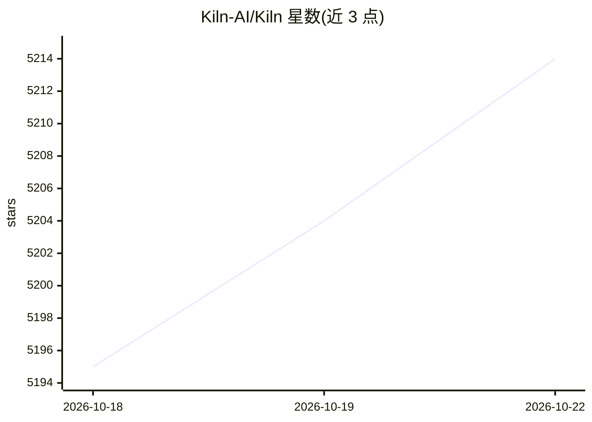

# Kiln-AI/Kiln

⭐ 5,214 · Python · NOASSERTION · 推送 2026-10-21 · [GitHub](https://github.com/Kiln-AI/Kiln) · [官网](https://kiln.tech) · 组织维护

**AI 开发工作台：评测、调优、微调、RAG 与 Agent 一体化**

桌面应用加 MIT 许可的 Python 库，覆盖 AI 开发闭环：任务与数据集定义、自动生成评测（judge + 合成数据集）、Auto-Optimize 自动搜索提示词/模型/工具组合、零代码微调（60+ 模型，经 Fireworks/Together/Vertex）、RAG、多级子代理与合成数据生成。桌面端面向全团队协作（PM/领域专家/QA 无需写代码），Git 原生同步；本地运行，可用自有 API key 或配合 Ollama 完全离线。核心库与 REST 服务为 MIT，桌面应用为 source-available fair-code 模式。

## 筛选速览

| 维度 | 判定 | 备注 |
|---|---|---|
| AI 角色 | `ai-ecosystem` | LLM/agent 周边工具 |
| 许可风险 | `none` | NOASSERTION |
| 部署形态 | `library` | 以包/库形式分发 |
| 模型依赖 | local-ok | 支持本地模型 |
| 硬件要求 | — | 无带数字的原话,不猜 |
| 安装摩擦 | `low` | 无编译、无系统依赖或容器化 |
| 成熟度 | — | 结构信号不足 |

## 能力要点

- 自动生成评测与 Auto-Optimize 搜索提示词/模型/工具组合
- 零代码微调 60+ 模型，支持 Fireworks/Together/Vertex 及 serverless 部署
- 拖拽文档（PDF/图像/视频/音频）建 RAG，并自动生成 RAG 评测
- 桌面端全团队协作 + MIT Python 库部署同一任务，190+ 模型测试覆盖

## 适用场景

- 为 AI 任务建立评测与提示词自动调优流程
- PM 与领域专家在 GUI 中标注数据，工程师用同一库部署
- 本地/离线（Ollama）运行 AI 任务，数据不出本机
- 生成合成数据集用于评测或微调

## 场景标签

`提示工程` `模型评测` `RAG` `微调` · 领域:Agent 开发

## 证据(README 行号)

> L31: Kiln is a workbench for the full AI development loop: evals, optimization, prompts, RAG, fine-tuning, synthetic dat
> L39: - 🚀 **Auto-Optimize** - Automatically find the best way to run your AI task, optimizing prompt, model selection, to
> L68: Most AI tooling forces a tradeoff: a code-only framework that covers one slice (orchestration *or* evals *or* RAG),

## 星数曲线

2026-10-18 5,195 → 2026-10-22 5,214（+19）

---
*卡片 v1 · prompt 1.4 · 生成 2026-10-20 · 置信度 high · 依据 README sha `f8f28a86f496` · [字段定义](../../DATASET.md)*
