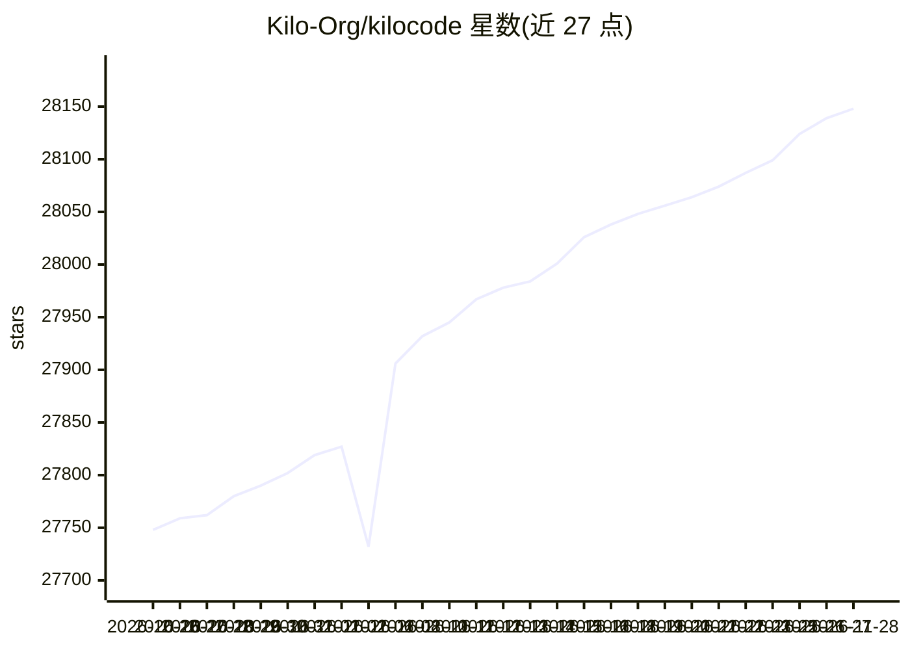

# Kilo-Org/kilocode

⭐ 28,148 · TypeScript · MIT · 推送 2026-11-27 · [GitHub](https://github.com/Kilo-Org/kilocode) · [官网](https://kilo.ai/) · 组织维护

**面向开发者的开源 AI 编码代理，覆盖 VS Code、JetBrains 与 CLI**

Kilo Code 是一个 agentic 编码平台，在 VS Code、JetBrains IDE 与 CLI 中运行，从自然语言生成代码。内置 Code/Plan/Ask/Debug 四种专用 agent 并支持自定义 agent；提供 500+ 模型可在任务中途切换，按模型提供商原价计费且无需 API key 即可开始。功能含多文件代码生成、内联补全、自检修正、终端与浏览器控制，以及可安装 agent/技能/MCP 服务器的 Marketplace；`kilo run --auto` 用于 CI/CD 流水线的无提示自治运行。CLI 是 OpenCode 的 fork，许可证为 MIT。

## 筛选速览

| 维度 | 判定 | 备注 |
|---|---|---|
| AI 角色 | `ai-native` | 本体是模型或模型工具 |
| 许可风险 | `permissive` | MIT |
| 部署形态 | `desktop` | 安装包/桌面程序 |
| 模型依赖 | — | README 未给出锁定关系 |
| 硬件要求 | — | 无带数字的原话,不猜 |
| 安装摩擦 | `low` | 无编译、无系统依赖或容器化 |
| 成熟度 | — | 结构信号不足 |

## 动量与使用信号

- 维护:`active` — 距上次 push 1.0 天,年发版 100,392 位贡献者
- 涨星:近 1 天 **+13**(自 20261016 起算)
- 安装:npm 包 `@kilocode/cli` 月下载 135,363
- 平台:WINDOWS / MACOS / LINUX · 协议:MCP

## 能力要点

- 多端运行：VS Code 扩展、JetBrains 插件、CLI 与网页端 Cloud Agent
- 500+ 模型可选，任务中切换，按提供商定价零加价
- Code/Plan/Ask/Debug 内置 agent，支持自定义与 Marketplace 扩展
- kilo run --auto 提供 CI/CD 流水线自治模式

## 适用场景

- 在 IDE 中用自然语言跨多文件生成和修改代码
- 在 CI/CD 流水线中自动运行测试并修复失败
- 对 pull request 设置自动化 AI 代码评审
- 安装 agent、技能与 MCP 服务器扩展编码代理能力

## 场景标签

`编码 Agent` `代码审查` · 领域:编码与开发

## 证据(README 行号)

> L9:  The open source coding agent for building with AI in VS Code, JetBrains, or the CLI.
> L20: Kilo Code is an AI coding agent that meets you everywhere you work: VS Code, JetBrains, and the CLI. It's open sour

## 星数曲线

2026-10-26 27,748 → 2026-11-28 28,148（+400）

---
*卡片 v1 · prompt 1.4 · 生成 2026-11-22 · 置信度 high · 依据 README sha `09b12f23161f` · [字段定义](../../DATASET.md)*
