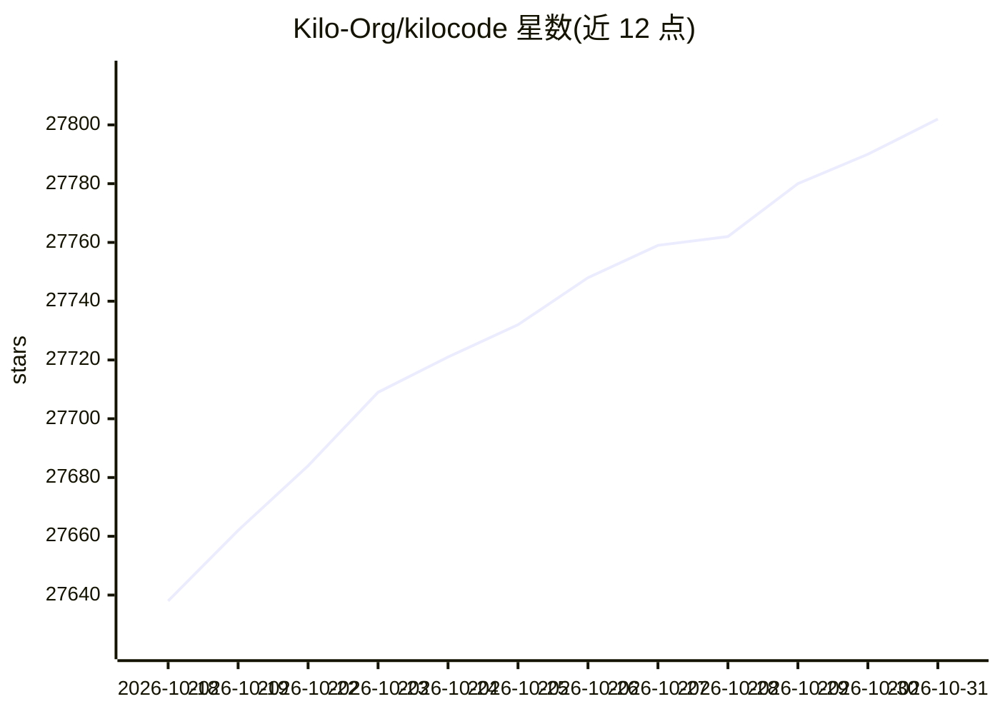

# Kilo-Org/kilocode

⭐ 27,802 · TypeScript · MIT · 推送 2026-10-30 · [GitHub](https://github.com/Kilo-Org/kilocode) · [官网](https://kilo.ai/) · 组织维护 · 中文 README

**面向开发者的多形态开源编码 Agent，覆盖 IDE 与 CLI**

Kilo Code 是可在 VS Code、JetBrains 和 CLI 中使用的 AI 编码 Agent，以 MIT 协议开源。内置 Code/Plan/Ask/Debug 四类专用 Agent 并支持自定义；提供自然语言多文件代码生成、行内补全、自检、终端与浏览器控制、Marketplace 扩展（agents/skills/MCP/plugins）。可选 500+ 模型并支持任务中途切换，按模型提供方原价计费，无需预先配置 API key。另有 Web 端 Cloud Agent 与 PR 自动代码评审入口，CLI 支持 --auto 无提示自主运行于 CI/CD。CLI 由 OpenCode fork 而来。

## 筛选速览

| 维度 | 判定 | 备注 |
|---|---|---|
| AI 角色 | `ai-native` | 本体是模型或模型工具 |
| 许可风险 | `permissive` | MIT |
| 部署形态 | `desktop` | 安装包/桌面程序 |
| 模型依赖 | — | README 未给出锁定关系 |
| 硬件要求 | — | 无带数字的原话,不猜 |
| 安装摩擦 | `low` | 无编译、无系统依赖或容器化 |
| 成熟度 | — | 结构信号不足 |

## 动量与使用信号

- 维护:`active` — 距上次 push 1.0 天,年发版 100,392 位贡献者
- 涨星:近 1 天 **+13**(自 20261016 起算)
- 安装:npm 包 `@kilocode/cli` 月下载 135,363
- 平台:WINDOWS / MACOS / LINUX · 协议:MCP

## 能力要点

- VS Code 扩展、JetBrains 插件、CLI 三种形态接入
- Code/Plan/Ask/Debug 四类内置 Agent，可自建自定义 Agent
- 500+ 模型可选，任务中途切换，按模型提供方原价计费
- --auto 参数支持无提示自主运行，面向 CI/CD 管线

## 适用场景

- 在 VS Code 或 JetBrains 中用自然语言生成和修改多文件代码
- 用 CLI 在 CI/CD 管线中自动跑测试并修复失败
- 对拉取请求设置自动化 AI 代码评审
- 在本地开发工作流中切换不同模型以匹配成本与延迟

## 场景标签

`编码 Agent` `代码生成` `代码审查` · 领域:编码与开发

## 证据(README 行号)

> L5:  The open source coding agent for building with AI in VS Code, JetBrains, or the CLI.
> L16: Kilo Code is an AI coding agent that meets you everywhere you work: VS Code, JetBrains, and the CLI. It's open sour
> L105: Kilo CLI is a fork of OpenCode, enhanced to work within the Kilo agentic engineering platform.

## 星数曲线

2026-10-18 27,638 → 2026-10-31 27,802（+164）

---
*卡片 v1 · prompt 1.4 · 生成 2026-10-18 · 置信度 high · 依据 README sha `f34f8f5f4034` · [字段定义](../../DATASET.md)*
