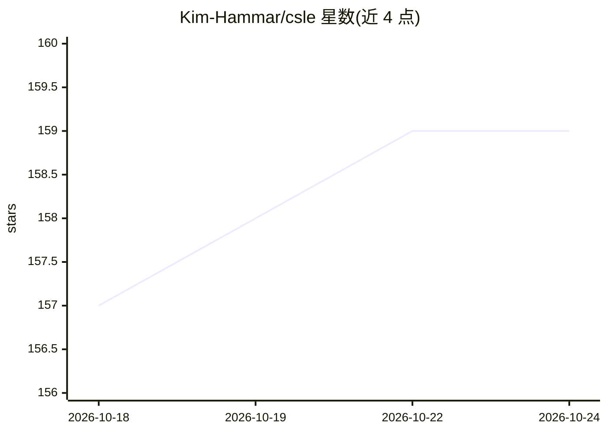

# Kim-Hammar/csle

⭐ 159 · Python · NOASSERTION · 推送 2026-09-14 · [GitHub](https://github.com/Kim-Hammar/csle) · [官网](https://kim-hammar.github.io/csle/) · 个人维护

**面向网络安全强化学习研究的仿真与仿真环境平台**

CSLE（Cyber Security Learning Environment）是用于在网络安全控制问题上训练与评估强化学习智能体的研究平台，包含三大子系统：基于 Linux 容器的大规模 IT 基础设施仿真系统（主要面向分布式集群，笔记本仅支持小规模仿真）、用于执行 RL 算法与模拟马尔可夫决策过程/马尔可夫博弈的仿真系统（兼容 OpenAI Gym/Gymnasium），以及可通过 CLI、REST API、Python 库与 Web 界面访问的管理系统。平台还支持将 RL 与动态规划、博弈论、进化方法、因果推断等定量方法结合。由 KTH 的 Kim Hammar 维护，附 arXiv 论文与 IEEE 论文引用条目，并提供 6400 条入侵轨迹数据集。

## 筛选速览

| 维度 | 判定 | 备注 |
|---|---|---|
| AI 角色 | `ai-ecosystem` | LLM/agent 周边工具 |
| 许可风险 | `none` | NOASSERTION |
| 部署形态 | `library` | 以包/库形式分发 |
| 模型依赖 | — | README 未给出锁定关系 |
| 硬件要求 | — | 无带数字的原话,不猜 |
| 安装摩擦 | `low` | 无编译、无系统依赖或容器化 |
| 成熟度 | — | 结构信号不足 |

## 能力要点

- 基于 Linux 容器的大规模 IT 基础设施与网络攻击仿真系统
- 兼容 OpenAI Gym/Gymnasium 的 MDP 与马尔可夫博弈仿真
- CLI/REST API/Python 库/Web 界面四种方式管理仿真与仿真
- 支持 RL 与动态规划、博弈论、进化方法、因果推断等方法结合

## 适用场景

- 在仿真的网络环境中训练和评估安全策略强化学习智能体
- 采集入侵轨迹数据用于安全研究
- 将强化学习与博弈论、因果推断等定量方法结合研究安全控制问题

## 场景标签

`网络安全` `强化学习` `科研工具` · 领域:学习与行业

## 证据(README 行号)

> L28: CSLE is a platform for evaluating and developing reinforcement learning agents for control problems in cybersecurit
> L58: CSLE includes a simulation system for executing reinforcement learning algorithms and simulating Markov decision
> L59: processes and Markov games. It is built in Python and can be integrated with standard machine learning libraries.

## 星数曲线

2026-10-18 157 → 2026-10-24 159（+2）

---
*卡片 v1 · prompt 1.4 · 生成 2026-10-22 · 置信度 mid · 依据 README sha `47adfba84a97` · [字段定义](../../DATASET.md)*
