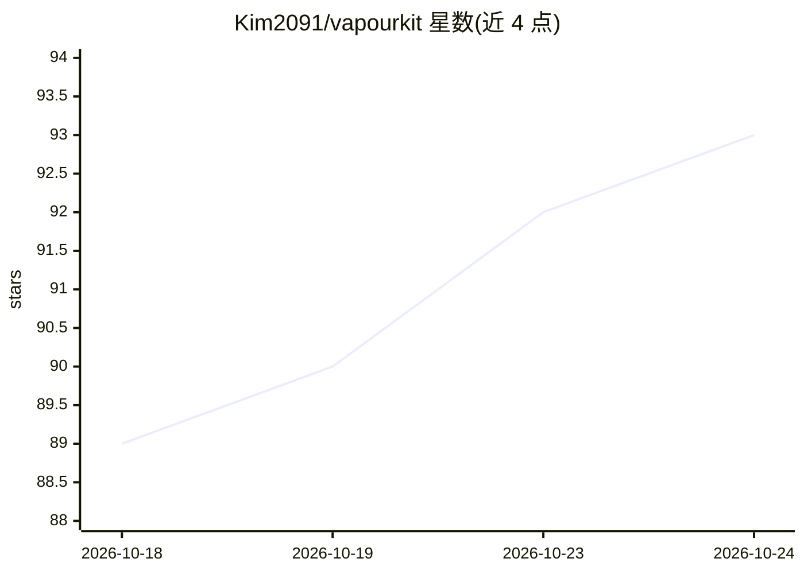

# Kim2091/vapourkit

⭐ 93 · TypeScript · GPL-3.0 · 推送 2026-10-24 · [GitHub](https://github.com/Kim2091/vapourkit) · [官网](https://www.vapourkit.app/) · 个人维护

**面向用户的 VapourSynth AI 视频超分/增强前端**

免费开源的视频超分与增强应用，基于 VapourSynth 处理管线与 AI 模型，运行于 Windows 与 Linux。推理后端按系统区分：Windows 支持 TensorRT、DirectML、NCNN Vulkan、MIGraphX；Linux 支持 NCNN Vulkan、TensorRT、MIGraphX。提供拖放选片、选模型、批处理队列、实时预览与源/输出对比查看器；支持数十种预置滤镜、自定义 VapourSynth 滤镜链、可保存的模板与工作流（.vkfilter/.vkworkflow）以及导入自定义 ONNX 模型。Windows 提供安装包，Linux 以 AppImage 分发，首次启动自动创建私有虚拟环境安装 VapourSynth、插件与模型。

## 筛选速览

| 维度 | 判定 | 备注 |
|---|---|---|
| AI 角色 | `ai-native` | 本体是模型或模型工具 |
| 许可风险 | `viral` | GPL-3.0 |
| 部署形态 | `desktop` | 安装包/桌面程序 |
| 模型依赖 | — | README 未给出锁定关系 |
| 硬件要求 | `gpu-8g` | |
| 安装摩擦 | `medium` | 含编译或系统依赖之一 |
| 成熟度 | — | 结构信号不足 |

## 能力要点

- AI 视频超分，支持 TensorRT/DirectML/NCNN Vulkan/MIGraphX 多推理后端
- 实时预览与内置源/输出并排对比查看器
- 批处理与可保存/分享的滤镜模板（.vkfilter）和工作流（.vkworkflow）
- 可导入自定义 ONNX 模型

## 适用场景

- 用 AI 模型对旧视频或低分辨率视频做超分修复
- 批量处理多个视频并套用自定义滤镜工作流
- 并排对比源视频与输出结果以检查处理效果

## 场景标签

`图像视频处理` · 领域:感知与多模态

## 证据(README 行号)

> L8: **Vapourkit** is a free, open-source application for upscaling and enhancing videos with VapourSynth and AI models. 
> L60: - **AI Video Upscaling**: Upscale videos with high-quality AI models

## 星数曲线

2026-10-18 89 → 2026-10-24 93（+4）

---
*卡片 v1 · prompt 1.4 · 生成 2026-10-23 · 置信度 mid · 依据 README sha `7bed15a6aa28` · [字段定义](../../DATASET.md)*
