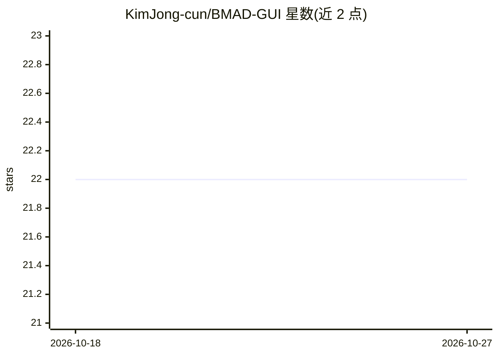

# KimJong-cun/BMAD-GUI

⭐ 22 · JavaScript · MPL-2.0 · 推送 2025-12-06 · [GitHub](https://github.com/KimJong-cun/BMAD-GUI) · 个人维护 · 中文 README

**BMAD Method + Claude Code 的可视化 Web 管理界面**

基于 Python aiohttp 的轻量 Web 界面，作为 Claude Code 的可视化外壳，管理基于 BMad Method 的项目开发流程：横向流程图展示分析→PRD→架构→Epic/Story→开发各阶段，四色状态系统标记进度，把文字选项转为可点击卡片，可向 Claude Code 发送命令并获取结果，通过 SSE 实时推送状态、监听项目文件变化。面向 AI 编程新手，需预先安装 Claude Code CLI 与 BMAD Method 模块；通过 git clone 源码安装，JSON 文件本地持久化存储。

## 筛选速览

| 维度 | 判定 | 备注 |
|---|---|---|
| AI 角色 | `ai-ecosystem` | LLM/agent 周边工具 |
| 许可风险 | `permissive` | MPL-2.0 |
| 部署形态 | `desktop` | 安装包/桌面程序 |
| 模型依赖 | — | README 未给出锁定关系 |
| 硬件要求 | — | 无带数字的原话,不猜 |
| 安装摩擦 | `low` | 无编译、无系统依赖或容器化 |
| 成熟度 | — | 结构信号不足 |

## 能力要点

- 工作流可视化：流程图 + 四色状态系统展示项目阶段与进度
- 向 Claude Code 发送命令并获取结果，SSE 实时状态推送
- Agent 管理与任务卡片式操作，文件变化自动检测
- 无前端框架依赖（Vanilla JS），JSON 本地存储

## 适用场景

- 用 BMad Method 推进项目时可视化跟踪各开发阶段
- 新手通过可点击卡片操作 Claude Code 而非手敲命令
- 集中管理项目的 Epic、Story 与 Sprint 进度

## 场景标签

`编码 Agent` · 领域:编码与开发

## 证据(README 行号)

> L9: BMAD GUI 是一个轻量级的 Web 界面，帮助用户更直观地管理和推进基于 BMad Method 的项目开发流程。它不是替代 Claude Code，而是作为一个可视化外壳，让开发过程更加清晰易懂。
> L66: - **命令执行** - 向 Claude Code 发送命令并获取结果

## 星数曲线

2026-10-18 22 → 2026-10-27 22（+0）

---
*卡片 v1 · prompt 1.4 · 生成 2026-10-27 · 置信度 mid · 依据 README sha `00f598b65329` · [字段定义](../../DATASET.md)*
