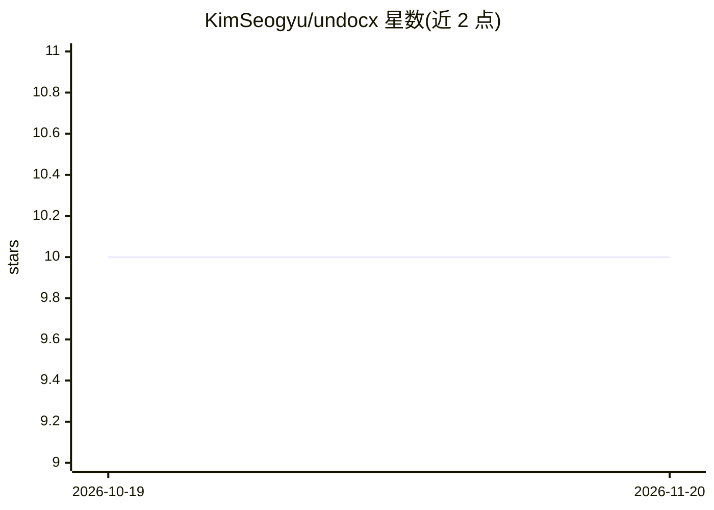

# KimSeogyu/undocx

⭐ 10 · Rust · MIT · 推送 2026-03-23 · [GitHub](https://github.com/KimSeogyu/undocx) · 个人维护

**面向 LLM/RAG 的 DOCX 转 Markdown 转换器**

用 Rust 编写并提供 Python 绑定的 DOCX→Markdown 转换工具，为 LLM/RAG 流水线做文档预处理：输出 Markdown，支持表格（colspan/rowspan）、脚注、批注、修订记录、嵌套列表与图片（内嵌 base64/存目录/跳过）。README 附带与 pandoc、markitdown 的基准对比（39 个文件×10 次迭代，自称 16.5 倍于 pandoc），并给出 RAG 场景建议（按 ## 标题切分、skip 图片降低 token）。提供 CLI 与 Python/Rust API，Rust 侧支持可插拔组件。

## 筛选速览

| 维度 | 判定 | 备注 |
|---|---|---|
| AI 角色 | `ai-enhanced` | 去掉 AI 部分产品仍成立 |
| 许可风险 | `permissive` | MIT |
| 部署形态 | `library` | 以包/库形式分发 |
| 模型依赖 | — | README 未给出锁定关系 |
| 硬件要求 | — | 无带数字的原话,不猜 |
| 安装摩擦 | `low` | 无编译、无系统依赖或容器化 |
| 成熟度 | — | 结构信号不足 |

## 能力要点

- 提供 CLI、Python API、Rust API 三种使用方式
- 支持表格、脚注/尾注/批注、修订记录、VML 旧格式图片等元素
- image_handling 选项支持 Inline/SaveToDir/Skip 三种图片处理
- Rust 侧提供 AstExtractor/Renderer 可插拔架构

## 适用场景

- RAG 摄取前把 DOCX 文档批量转成 Markdown
- 保留脚注与批注做全上下文的文档问答语料准备
- 需要处理含修订记录的 Word 文档转文本

## 场景标签

`文档解析` · 领域:知识与检索

## 证据(README 行号)

> L8: **Fast, accurate DOCX to Markdown converter built for LLM/RAG pipelines.** Written in Rust with Python bindings.
> L76: Designed for document preprocessing in LLM/RAG pipelines.

## 星数曲线

2026-10-19 10 → 2026-11-20 10（+0）

---
*卡片 v1 · prompt 1.4 · 生成 2026-11-20 · 置信度 mid · 依据 README sha `8396c6afae48` · [字段定义](../../DATASET.md)*
