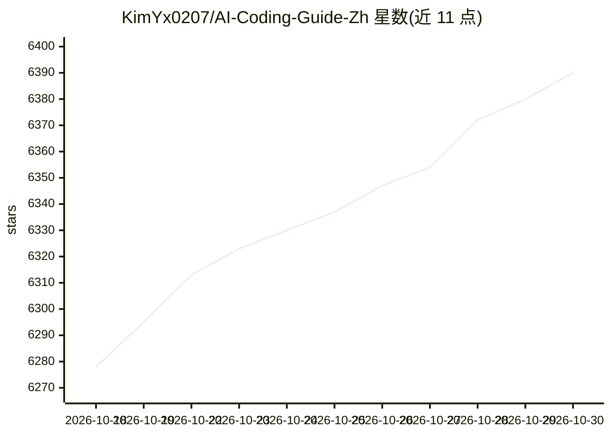

# KimYx0207/AI-Coding-Guide-Zh

⭐ 6,390 · Python · MIT · 推送 2026-10-28 · [GitHub](https://github.com/KimYx0207/AI-Coding-Guide-Zh) · 个人维护 · 中文 README

**面向中文初学者的 AI 编程工具四线实战教程集**

由个人作者「老金」维护的中文 AI Coding / Agent 教程仓库：围绕 Claude Code、OpenClaw、Codex、WorkBuddy 四类工具组织 50 篇教程与 1 张速查卡，按编程、助手、Agent、办公四条学习路径分层阅读。每条入门路线配虚构数据练习材料与结果对照，关键版本号对照官方 Release 修订并附逐章核查清单。读者可克隆仓库获取示例文件；工具本身的安装、账号与用量费用由所选服务方收取，教程内容以 MIT 许可免费阅读。

## 筛选速览

| 维度 | 判定 | 备注 |
|---|---|---|
| AI 角色 | `ai-knowledge` | 知识聚合/清单类 |
| 许可风险 | `permissive` | MIT |
| 部署形态 | `library` | 以包/库形式分发 |
| 模型依赖 | — | README 未给出锁定关系 |
| 硬件要求 | — | 无带数字的原话,不猜 |
| 安装摩擦 | `low` | 无编译、无系统依赖或容器化 |
| 成熟度 | — | 结构信号不足 |

## 能力要点

- 50 篇教程 + 1 张速查卡，覆盖四个工具主线
- 入门任务配可复制素材、结果对照与变式练习
- 版本号对照官方 Release 修订，附逐章核查清单（2026-10-03 全量检查）
- 120万+ Markdown 字符、3100+ 代码块示例、500+ FAQ

## 适用场景

- 零基础第一次使用 AI 编程助手，按主线循序渐进学习
- 产品经理或不写代码的同事学习 AI 办公工作流
- 团队负责人用于培训选型与协作规范制定

## 场景标签

`教程课程` · 领域:学习与行业

## 证据(README 行号)

> L16: > 这套中文 AI 编程教程由老金维护，面向第一次使用编程助手的学习者、产品经理和独立开发者。先用 Claude Code 或 Codex 完成一次小改动，再按需要学习 OpenClaw 助手和 WorkBuddy 办公工作流。每
> L55: 这是一套可以循序学习，也能用于团队培训和项目实践的 **AI Coding 与 Agent 工作流中文教程**，覆盖四类代表性工具：
> L283: |**教程总数**|50 篇完整教程（Claude Code 13 / OpenClaw 12 / Codex 14 / WorkBuddy 11）+ 1 速查卡|

## 星数曲线

2026-10-18 6,278 → 2026-10-30 6,390（+112）

---
*卡片 v1 · prompt 1.4 · 生成 2026-10-20 · 置信度 mid · 依据 README sha `9c7f06b7766f` · [字段定义](../../DATASET.md)*
