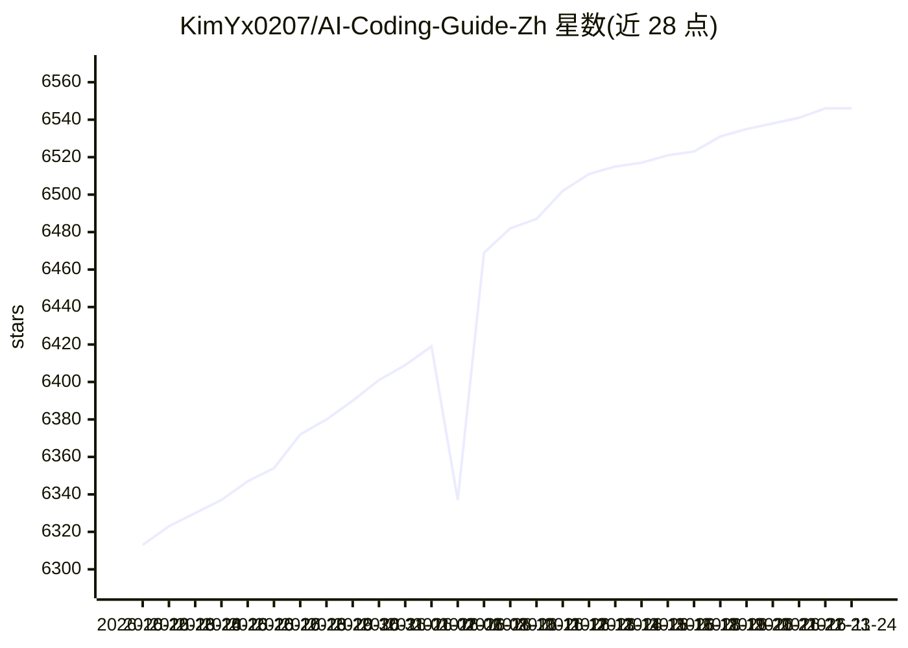

# KimYx0207/AI-Coding-Guide-Zh

⭐ 6,546 · Python · MIT · 推送 2026-11-09 · [GitHub](https://github.com/KimYx0207/AI-Coding-Guide-Zh) · 个人维护 · 中文 README

**面向零基础中文用户的 Claude Code/Codex/WorkBuddy/OpenClaw 教程集**

由个人维护的中文 AI 编程与 Agent 工作流教程仓库，覆盖四条工具线：Claude Code 编程（13 篇）、Codex App（14 篇）、腾讯 WorkBuddy 办公（11 篇）、OpenClaw 助手（12 篇），共 50 篇教程加 1 张速查卡。每条线提供安装、入门任务、练习材料与结果对照，含 3100+ 代码块示例与 500+ FAQ；版本号声明对照官方 Release 与文档核查。采用 MIT 许可，通过 git clone 获取练习材料，不含可运行的软件本体。

## 筛选速览

| 维度 | 判定 | 备注 |
|---|---|---|
| AI 角色 | `ai-knowledge` | 知识聚合/清单类 |
| 许可风险 | `permissive` | MIT |
| 部署形态 | `library` | 以包/库形式分发 |
| 模型依赖 | — | README 未给出锁定关系 |
| 硬件要求 | — | 无带数字的原话,不猜 |
| 安装摩擦 | `low` | 无编译、无系统依赖或容器化 |
| 成熟度 | — | 结构信号不足 |

## 能力要点

- 50 篇教程 + 1 速查卡，四条工具线学习路径
- 入门任务附带练习材料与结果对照
- 声明版本号按官方 Release/文档核查（2026-10-03 全量检查）
- 3100+ 代码示例与 500+ FAQ 条目

## 适用场景

- 零基础学 Claude Code 或 Codex 完成第一次 AI 代码修改
- 非技术同事学 WorkBuddy 做周报和表格整理
- 按任务场景查找对应工具的中文教程

## 场景标签

`教程课程` · 领域:学习与行业

## 证据(README 行号)

> L16: > 这套中文 AI 编程教程由老金维护，面向第一次使用编程助手的学习者、产品经理和独立开发者。先用 Claude Code 或 Codex 完成一次小改动，再按需要学习 WorkBuddy 办公工作流，OpenClaw 助手排在最
> L57: 这是一套可以循序学习，也能用于团队培训和项目实践的 **AI Coding 与 Agent 工作流中文教程**，覆盖四类代表性工具：
> L283: |**教程总数**|50 篇完整教程（Claude Code 13 / OpenClaw 12 / Codex 14 / WorkBuddy 11）+ 1 速查卡|

## 星数曲线

2026-10-22 6,313 → 2026-11-24 6,546（+233）

---
*卡片 v1 · prompt 1.4 · 生成 2026-11-22 · 置信度 mid · 依据 README sha `f59280b5cdec` · [字段定义](../../DATASET.md)*
