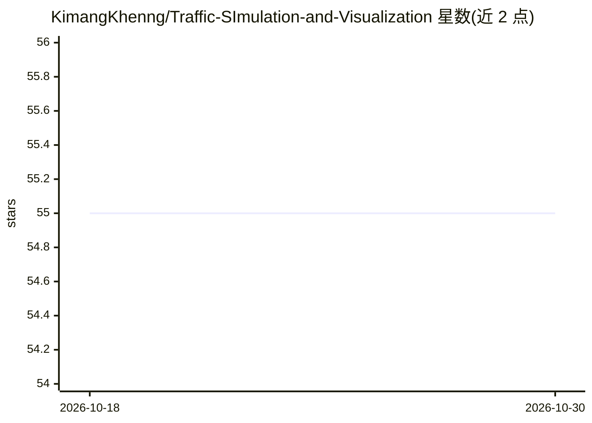

# KimangKhenng/Traffic-SImulation-and-Visualization

⭐ 55 · C++ · GPL-3.0 · 推送 2025-11-08 · [GitHub](https://github.com/KimangKhenng/Traffic-SImulation-and-Visualization) · 个人维护

**C++/Qt5 编写的十字路口交通仿真与可视化桌面软件**

开源 GPLv3 的跨平台 Qt5 桌面应用，按可调速率生成到达车辆并在界面中实时仿真与可视化十字路口交通；可实时切换车辆行为模式（是否遵守红绿灯、是否视前车为不可见）。提供 CMake/qmake/Qt Creator 多种构建方式，曾在 Windows 10、macOS Big Sur、Ubuntu 20.04 上编译测试。README 主题标签含 artificial-intelligence，但正文未描述任何模型或 AI 功能。

## 筛选速览

| 维度 | 判定 | 备注 |
|---|---|---|
| AI 角色 | `ai-enhanced` | 去掉 AI 部分产品仍成立 |
| 许可风险 | `viral` | GPL-3.0 |
| 部署形态 | `None` |  |
| 模型依赖 | — | README 未给出锁定关系 |
| 硬件要求 | — | 无带数字的原话,不猜 |
| 安装摩擦 | `medium` | 含编译或系统依赖之一 |
| 成熟度 | — | 结构信号不足 |

## 能力要点

- 按可变速率生成车辆并实时仿真可视化
- 运行时切换车辆行为模式（红绿灯遵守、前车可见性）
- 支持 CMake/qmake/Qt Creator 多种构建方式
- 提供 Windows x86/x64 二进制发布

## 适用场景

- 教学或课程演示十字路口交通流行为
- 调整车辆到达率与行为参数观察交通现象
- 作为 Qt5/CMake 跨平台 C++ 工程的学习样例

## 场景标签

 · 领域:交通仿真/桌面应用

## 证据(README 行号)

> L11: This is an intersection simulation software capable of generating the arriving vehicles in many varying controllabl
> L17: - Real-time traffic simulation and visualization

## 星数曲线

2026-10-18 55 → 2026-10-30 55（+0）

---
*卡片 v1 · prompt 1.4 · 生成 2026-10-24 · 置信度 low · 依据 README sha `917e5938ec68` · [字段定义](../../DATASET.md)*
