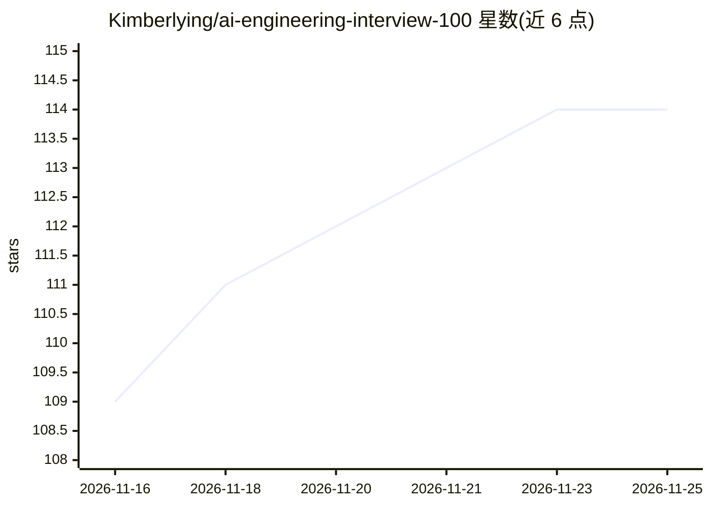

# Kimberlying/ai-engineering-interview-100

⭐ 114 · Python · MIT · 推送 2026-11-16 · [GitHub](https://github.com/Kimberlying/ai-engineering-interview-100) · 个人维护 · 中文 README

**AI 工程面试题手册：100 道生产实战题与 7 个端到端架构设计**

面向准备 AI 工程面试的开发者的知识手册仓库：收录 100 道基于生产事故与系统设计的题目，覆盖 LLM 基础、RAG、Agent、微调、推理部署、生产可靠性、治理与成本控制 8 个部分，其中 7 题为端到端系统设计（如企业多源知识助手、多租户推理平台）。每题附核心概念拆解、诊断路径与工程级答案，并总结两条资深架构师的排查准则（检索/生成二分定位、SLA/SLO 工程契约）。提供英文与简体中文双语版本，以 Markdown 文档形式阅读，无需安装运行。

## 筛选速览

| 维度 | 判定 | 备注 |
|---|---|---|
| AI 角色 | `ai-knowledge` | 知识聚合/清单类 |
| 许可风险 | `permissive` | MIT |
| 部署形态 | `None` |  |
| 模型依赖 | — | README 未给出锁定关系 |
| 硬件要求 | — | 无带数字的原话,不猜 |
| 安装摩擦 | `low` | 无编译、无系统依赖或容器化 |
| 成熟度 | — | 结构信号不足 |

## 能力要点

- 100 道基于生产场景的题目，含核心概念拆解与诊断路径
- 7 个端到端系统设计（企业知识助手、多租户 LLM 平台等）
- 覆盖 LLM/RAG/Agent/微调/推理/可靠性/治理 8 大主题
- 英中双语 README，接受 PR 贡献

## 适用场景

- 准备 AI 工程师或 LLM 相关岗位面试
- 学习生产环境 AI 系统的故障排查与架构设计思路
- 作为团队内 AI 系统设计评审的参考题库

## 场景标签

`教程课程` · 领域:学习与行业

## 证据(README 行号)

> L1: # 100 Questions That Haunt AI Engineering Interviews in 2026
> L4:  Covering LLM Foundations, RAG, Autonomous Agents, Fine-tuning, Inference & Serving, Production Reliability, Governa
> L24: This repository compiles all **100 production-grounded questions**, enriched with **core conceptual breakdowns, ste

## 星数曲线

2026-11-16 109 → 2026-11-25 114（+5）

---
*卡片 v1 · prompt 1.4 · 生成 2026-11-17 · 置信度 high · 依据 README sha `f7f267766b7c` · [字段定义](../../DATASET.md)*
