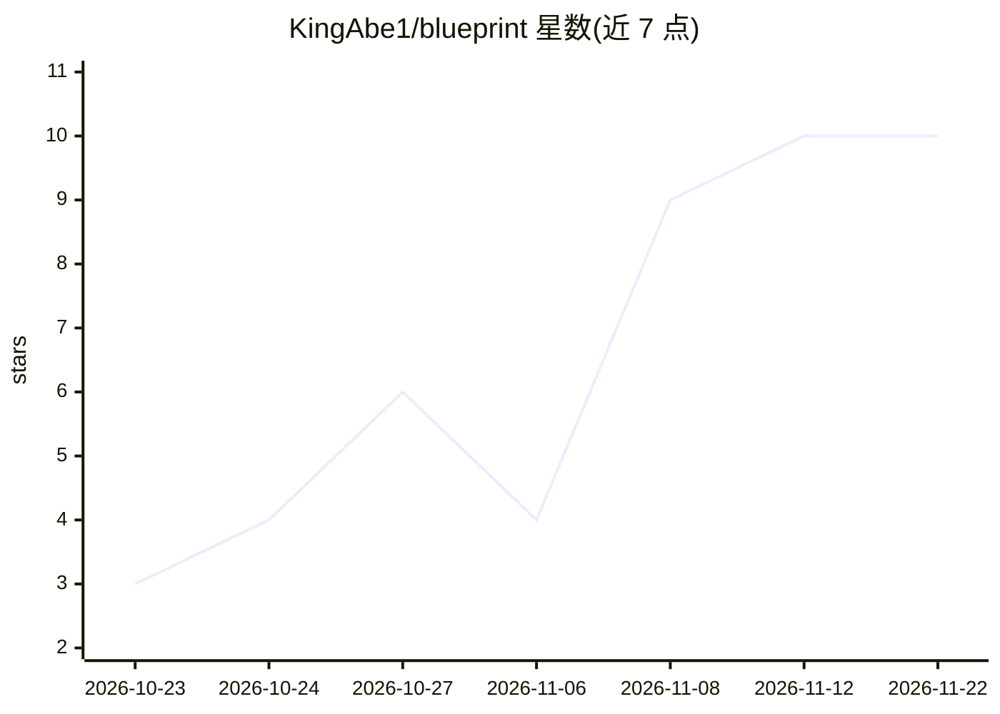

# KingAbe1/blueprint

⭐ 10 · TypeScript · MIT · 推送 2026-11-07 · [GitHub](https://github.com/KingAbe1/blueprint) · [官网](https://blueprint-web-chi.vercel.app/) · 个人维护

**本地工作室：AI agent 交接文档生成与代码库质量扫描**

在本地运行的规划与扫描工作室：将产品简报转化为架构图与可编辑的 agent 交接文档，或扫描既有仓库生成概览、依赖、脚本、健康分、CVE 与可选 AI 文件审查。支持浏览器与 Tauri 桌面端，规格与扫描结果留在本机，AI 调用仅发往用户自行配置的 provider，无托管后端。macOS 安装包未经 Apple 公证，需一行 Terminal 命令解除隔离。

## 筛选速览

| 维度 | 判定 | 备注 |
|---|---|---|
| AI 角色 | `ai-enhanced` | 去掉 AI 部分产品仍成立 |
| 许可风险 | `permissive` | MIT |
| 部署形态 | `desktop` | 安装包/桌面程序 |
| 模型依赖 | local-ok | 支持本地模型 |
| 硬件要求 | — | 无带数字的原话,不猜 |
| 安装摩擦 | `low` | 无编译、无系统依赖或容器化 |
| 成熟度 | — | 结构信号不足 |

## 能力要点

- 产品简报→架构图→可编辑 agent 交接文档，导出给 Cursor/VS Code/Claude Code 等工具
- 代码库扫描含健康分、CVE、Next.js/Remix/Expo/Node 深度画像
- 本地优先：规格与扫描留在磁盘，AI 请求直连用户配置的 provider
- 桌面安装包覆盖 macOS（aarch64/x64）、Windows（msi/NSIS）、Linux（deb/AppImage）

## 适用场景

- 启动新项目前生成架构图与 agent 交接包
- 扫描既有仓库查看依赖、健康分与 CVE
- 从扫描发现直接跳转到 IDE 的文件与行号

## 场景标签

 · 领域:开发者工具/代码质量

## 证据(README 行号)

> L7: 	Local studio for agent handoffs and codebase quality reports.
> L31: Works in the **browser** or as a **desktop app** (Tauri). Use desktop for reliable folder access and writing handof
> L36: - **Scan what you already have.** Overview, tree, dependencies, scripts, health score, CVEs, and optional AI review
> L39: - **Your AI, your keys.** Optional providers (OpenAI, Anthropic, Gemini, Ollama, OpenRouter, Groq, DeepSeek, Mistra

## 星数曲线

2026-10-23 3 → 2026-11-22 10（+7）

---
*卡片 v1 · prompt 1.4 · 生成 2026-11-20 · 置信度 high · 依据 README sha `04bf6c3aec27` · [字段定义](../../DATASET.md)*
