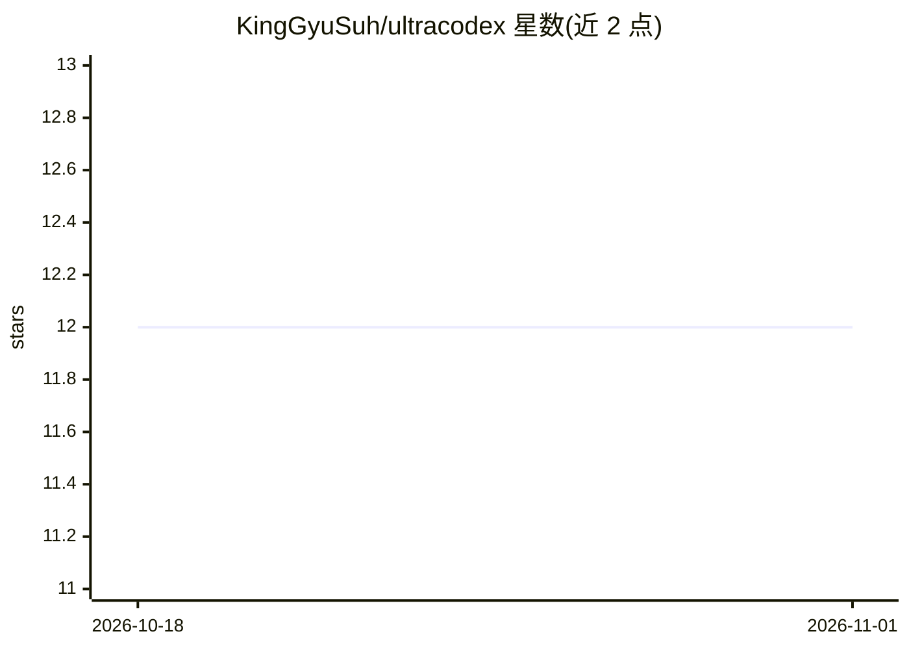

# KingGyuSuh/ultracodex

⭐ 12 · Apache-2.0 · 推送 2026-07-17 · [GitHub](https://github.com/KingGyuSuh/ultracodex) · 个人维护 · 中文 README

**Claude Code 插件：在 ultracode 工作流中混入 Codex 节点做跨模型校验**

单一技能（codex-workflow）形式的 Claude Code 插件：教 Claude 在 Workflow（ultracode）编排中，把 verify/judge/二次意见类节点改为通过 codex exec 由 Codex（GPT 系）执行，其余 find/generate/synthesize 节点仍由 Claude 完成，编排逻辑保留在 Claude 的 JavaScript 中。提供 codexNode 辅助函数（JSON Schema 单一来源、revalidate、超时看门狗）与四个可复制工作流模板。前置条件为 ultracode 模式、已登录的 Codex CLI 与 POSIX shell；每个 codex 节点产生 Anthropic 与 OpenAI 双计费面，长时间任务需另行转交后台执行。

## 筛选速览

| 维度 | 判定 | 备注 |
|---|---|---|
| AI 角色 | `ai-ecosystem` | LLM/agent 周边工具 |
| 许可风险 | `permissive` | Apache-2.0 |
| 部署形态 | `None` |  |
| 模型依赖 | locked-api |  |
| 硬件要求 | — | 无带数字的原话,不猜 |
| 安装摩擦 | `low` | 无编译、无系统依赖或容器化 |
| 成熟度 | — | 结构信号不足 |

## 能力要点

- codexNode 辅助函数：schema 单一来源、revalidate 校验、背景 Bash 与超时看门狗
- 四个完整工作流模板（跨模型评审、混合评审团、单结论交叉核验、loop-until-dry）
- 按节点指定 model/effort 的分层路由（低成本批量校验或高投入关键裁决）
- 安装前 preflight 检查 Codex CLI 存在、认证与结构化输出路径

## 适用场景

- 用不同模型家族对抗式核验 Claude 的发现，降低相关联误报
- 组建无自我偏好偏见的混合模型评审团
- 在报告或发布前对高风险结论做跨模型二次意见

## 场景标签

`编码 Agent` `代码审查` · 领域:编码与开发

## 证据(README 行号)

> L11: `ultracodex` is an open-source Claude Code plugin — a single skill,
> L14: Claude Code's `agent()` / `pipeline()` / `parallel()` orchestration tool, a.k.a.
> L178: Claude then authors a Workflow whose verify/judge nodes shell out to `codex exec`

## 星数曲线

2026-10-18 12 → 2026-11-01 12（+0）

---
*卡片 v1 · prompt 1.4 · 生成 2026-11-01 · 置信度 high · 依据 README sha `97d5243a2caf` · [字段定义](../../DATASET.md)*
