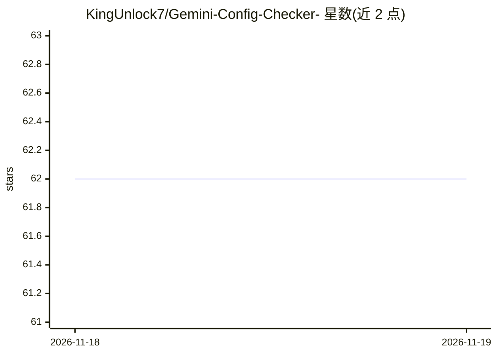

# KingUnlock7/Gemini-Config-Checker-

⭐ 62 · Go · Apache-2.0 · 推送 2026-11-18 · [GitHub](https://github.com/KingUnlock7/Gemini-Config-Checker-) · 个人维护

**检测代理配置能否登录使用 Google AI Studio/Gemini 的工具**

以本地桌面/Web 应用形式运行的链式区域扫描器：将用户提供的 vless/vmess/trojan/ss 配置（链接、订阅 URL 或 base64）逐一通过登录状态的浏览器实测，读取 Google 对签署账号的区域判定，而非仅做连通性探测。支持 Simple（检测自有配置）与 Advanced（将免费配置链在可用基础配置之后）两种模式，内置反 DPI 分片配置（Finalmask/指纹/ALPN/密码套件，可编辑），可导出链接、base64 或链式 Xray 配置。提供 Windows/macOS/Linux 桌面构建、Android APK（仅连通性模式）与 Web server 构建。

## 筛选速览

| 维度 | 判定 | 备注 |
|---|---|---|
| AI 角色 | `ai-enhanced` | 去掉 AI 部分产品仍成立 |
| 许可风险 | `permissive` | Apache-2.0 |
| 部署形态 | `desktop` | 安装包/桌面程序 |
| 模型依赖 | — | README 未给出锁定关系 |
| 硬件要求 | — | 无带数字的原话,不猜 |
| 安装摩擦 | `medium` | 含编译或系统依赖之一 |
| 成熟度 | `idea` | |

## 能力要点

- 登录状态浏览器实测区域可用性（AI Studio 重定向与 Gemini 区域墙判定）
- Simple/Advanced 双模式：自有配置检测与免费配置链式出口扫描
- 可编辑的反 DPI 分片配置，含本地分片转发器
- 导出链接/base64/链式 Xray 配置，结果按状态过滤与排序

## 适用场景

- 在使用前批量检测手里的代理配置能否进入 AI Studio/Gemini
- Cloudflare 配置连通但出口被 Google 区域墙拦截时，寻找其他可用出口
- 在受过滤网络中验证反 DPI 配置的连接效果

## 场景标签

 · 领域:网络工具/代理检测

## 证据(README 行号)

> L11: Find proxy configs that actually get you into **Google AI Studio and Gemini**, by testing each one the way a person
> L14: > **Version 0.1.0, early pre-release.** It works end to end on Windows (the only platform it has been run on so far

## 星数曲线

2026-11-18 62 → 2026-11-19 62（+0）

---
*卡片 v1 · prompt 1.4 · 生成 2026-11-19 · 置信度 high · 依据 README sha `7d4e3e000e83` · [字段定义](../../DATASET.md)*
