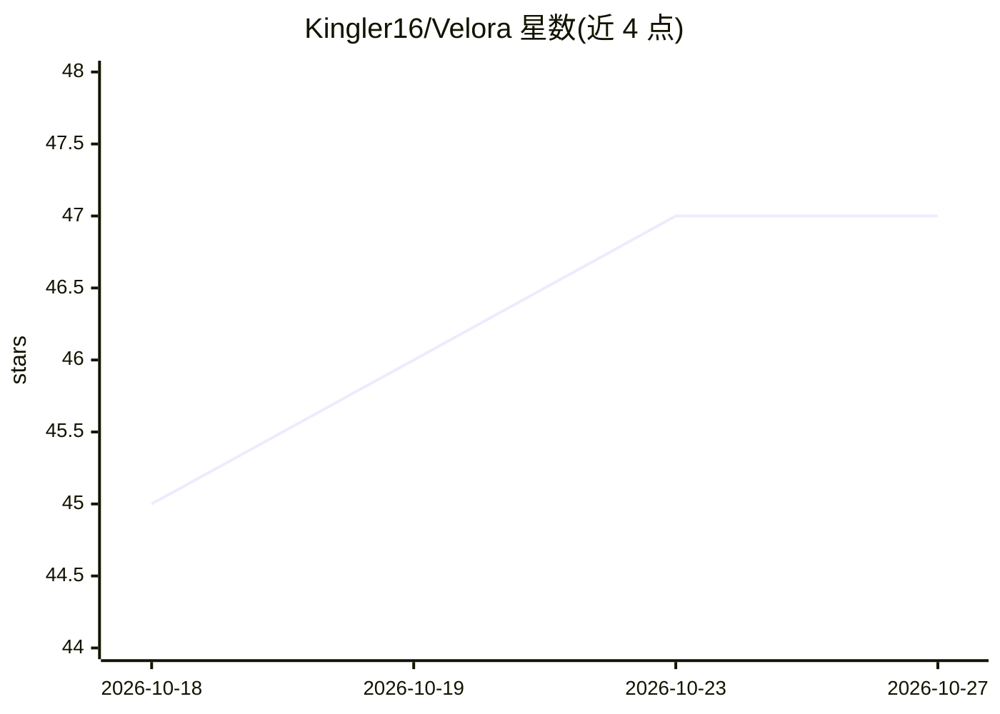

# Kingler16/Velora

⭐ 47 · Python · MIT · 推送 2026-10-14 · [GitHub](https://github.com/Kingler16/Velora) · [官网](https://kingler16.github.io/Velora/) · 个人维护

**个人财富顾问应用：AI 投资简报与组合监控，经 Telegram/Web 交付**

面向个人投资者的自托管财富管理应用：定期采集 yfinance/FRED/ECB/新闻等数据，通过 Claude Code CLI（--print 模式，使用 Claude Max/Pro 订阅而非 API key）生成双周简报、月度报告与个股深度分析，交付到 Telegram 机器人与 FastAPI 网页仪表盘（7 页面、de/en 双语）。支持多账户多币种组合追踪、BUY/SELL/WATCH 建议跟踪与自然语言记账。部署面向树莓派等低功耗常开设备（约 90MB 内存），声明仅供参考、非投资建议。

## 筛选速览

| 维度 | 判定 | 备注 |
|---|---|---|
| AI 角色 | `ai-native` | 本体是模型或模型工具 |
| 许可风险 | `permissive` | MIT |
| 部署形态 | `library` | 以包/库形式分发 |
| 模型依赖 | locked-api |  |
| 硬件要求 | — | 无带数字的原话,不猜 |
| 安装摩擦 | `low` | 无编译、无系统依赖或容器化 |
| 成熟度 | — | 结构信号不足 |

## 能力要点

- 通过 Claude Code CLI 的 --print 模式调用 Claude Opus，使用 Max/Pro 订阅、无 API 费用
- 7 页面自托管 Web 仪表盘 + Telegram 机器人（简报/记账/个股分析/自由对话）
- 多账户多币种组合追踪、税损收割、基准对比、建议命中率统计
- 可在树莓派等约 90MB 内存低功耗设备上运行，cron + systemd 自动化

## 适用场景

- 每周自动收到覆盖我持仓的 AI 市场简报
- 通过 Telegram 用自然语言记录交易并查询组合状态
- 在低功耗家用服务器上长期运行个人投资仪表盘

## 场景标签

`金融量化` `聊天机器人` · 领域:对话与助手

## 证据(README 行号)

> L16: Twice a week, Velora collects market data for your entire portfolio, pulls macroeconomic indicators, searches for r
> L98: Velora does **not** call the Claude API directly. It shells out to Claude Code CLI in `--print` mode — no API key n

## 星数曲线

2026-10-18 45 → 2026-10-27 47（+2）

---
*卡片 v1 · prompt 1.4 · 生成 2026-10-25 · 置信度 mid · 依据 README sha `800a12dd1a07` · [字段定义](../../DATASET.md)*
