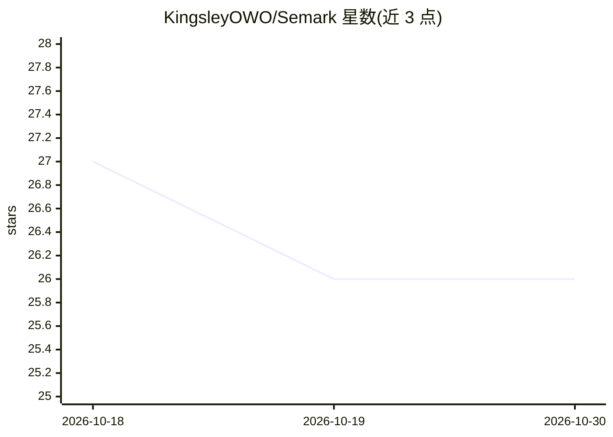

# KingsleyOWO/Semark

⭐ 26 · Python · Apache-2.0 · 推送 2026-10-27 · [GitHub](https://github.com/KingsleyOWO/Semark) · 个人维护 · 中文 README

**自托管文档处理服务：把 PDF/Office/图片转为 RAG 可用的语义 Markdown**

基于 Docker 部署的自托管服务：用 MinerU 与原生 Word 解析提取文本、表格与图片，将表单、流程图、图表和软件截图交给用户选择的视觉模型（本地 Ollama 或任意 OpenAI 兼容 API）转为可检索文本，再逐页与源文件比对核验，输出 main.md、chunks.jsonl、来源映射与质量报告，可直接导入知识库。限制：核验耗时（97 页文档约 6 小时）、API 无鉴权不建议暴露公网、核验可关闭（agentic.mode=off）。

## 筛选速览

| 维度 | 判定 | 备注 |
|---|---|---|
| AI 角色 | `ai-ecosystem` | LLM/agent 周边工具 |
| 许可风险 | `permissive` | Apache-2.0 |
| 部署形态 | `self-host` | docker 或自建部署 |
| 模型依赖 | local-ok | 支持本地模型 |
| 硬件要求 | — | 无带数字的原话,不猜 |
| 安装摩擦 | `low` | 无编译、无系统依赖或容器化 |
| 成熟度 | — | 结构信号不足 |

## 能力要点

- MinerU + VLM 双阶段解析，截图/流程图/表单转为结构化 Markdown
- 逐页与源文件比对核验，未核验部分明确标注而非猜测
- 输出 chunks.jsonl 与来源映射，可直接导入 RAG 知识库
- 可全程本地运行（Ollama），文档不离开本机

## 适用场景

- 把含大量截图与表单的手册转成可检索的知识库文档
- 为 RAG 系统准备带来源映射与核验标签的干净语料
- 在本地或局域网内处理不愿外发的敏感文档

## 场景标签

`文档解析` · 领域:知识与检索

## 证据(README 行号)

> L7: Semark is a self-hosted document processing service. It extracts text, tables and pictures with MinerU and native Wo
> L60: - `documents/`: the package to import into RAG — `main.md` plus a document for each picture, table and form. Its te
> L61: - `chunks.jsonl`: ready-made chunks, each carrying its source block IDs.

## 星数曲线

2026-10-18 27 → 2026-10-30 26（-1）

---
*卡片 v1 · prompt 1.4 · 生成 2026-10-26 · 置信度 high · 依据 README sha `1b9b3a838c9b` · [字段定义](../../DATASET.md)*
