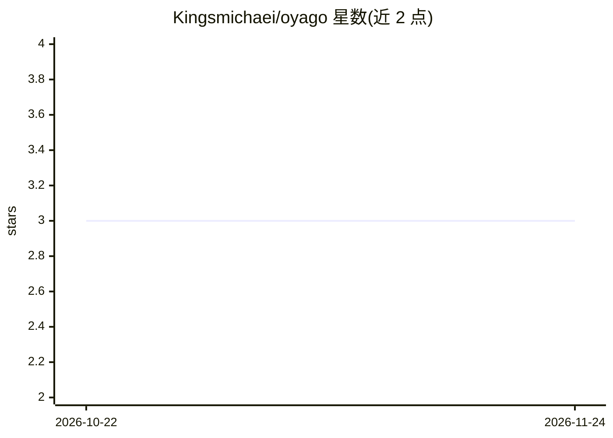

# Kingsmichaei/oyago

⭐ 3 · 推送 2026-10-09 · [GitHub](https://github.com/Kingsmichaei/oyago) · [官网](https://oyago-web.onrender.com) · 个人维护

**给拉各斯居民用英语/皮钦语生成巴士出行指引的 RAG 应用**

面向拉各斯出行的问答应用：基于 Gemma 3 27B 开放权重模型，通过 Backboard RAG 保存社区路线知识（lagos_routes.md 与社区上传路线），结合用户保存的常用地点（家、上班地、教堂）生成逐步出行指引，支持英语与皮钦语。提供 FastAPI 后端（/ask、/locate 等端点）与 React+Vite+Tailwind 的可安装 PWA 前端；定位功能将 GPS 匹配最近公交站，无匹配时回退 OpenStreetMap Nominatim，坐标不存储不发送给模型。

## 筛选速览

| 维度 | 判定 | 备注 |
|---|---|---|
| AI 角色 | `ai-native` | 本体是模型或模型工具 |
| 许可风险 | `none` | — |
| 部署形态 | `library` | 以包/库形式分发 |
| 模型依赖 | — | README 未给出锁定关系 |
| 硬件要求 | — | 无带数字的原话,不猜 |
| 安装摩擦 | `low` | 无编译、无系统依赖或容器化 |
| 成熟度 | `idea` | |

## 能力要点

- Backboard RAG 存储社区路线，回答基于真实路线数据
- Backboard memory 保存用户常用地点
- GPS 坐标匹配最近站点，回退 OpenStreetMap Nominatim
- React+Vite+Tailwind PWA 可安装到手机

## 适用场景

- 用英语或皮钦语查询拉各斯 danfo/BRT 等出行路线
- 输入目的地自动使用已定位的起点
- 社区贡献并维护本地路线知识库

## 场景标签

`RAG` `文档问答` · 领域:知识与检索

## 证据(README 行号)

> L5: **Ask how to reach anywhere in Lagos by danfo, BRT, keke or okada, in English or Pidgin.**
> L17: |**Open-weight model** (Gemma 3 27B by default)|Writes the directions in the user's own style|
> L18: |**Backboard RAG**|Holds the route knowledge (`backend/data/lagos_routes.md` + community routes), so answers come f

## 星数曲线

2026-10-22 3 → 2026-11-24 3（+0）

---
*卡片 v1 · prompt 1.4 · 生成 2026-11-22 · 置信度 high · 依据 README sha `89eb2ecce5fe` · [字段定义](../../DATASET.md)*
