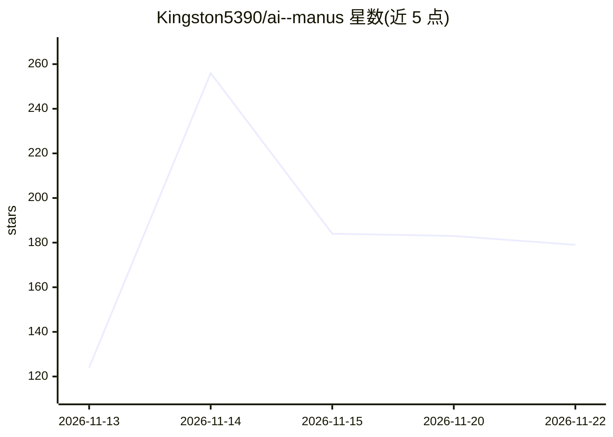

# Kingston5390/ai--manus

⭐ 179 · Apache-2.0 · 推送 2026-11-15 · [GitHub](https://github.com/Kingston5390/ai--manus) · 个人维护

**面向个人用户的自主 AI Agent：代跑代码并操作浏览器**

Manus 定位为自主 AI Agent，宣称可代替用户编写并执行脚本、控制浏览器（导航页面、填写表单、采集信息）并完成多步骤任务，面向学习、家庭与轻办公等小规模场景，强调无需编程背景。README 以功能介绍与使用建议为主，说明跨会话复用任务模式；给出 4GB/双核起的兼容性表。但全文未提供任何安装命令、代码仓库结构、模型接入方式或下载链接的具体说明，仅出现“Download Manus / PROMO2026”字样。

## 筛选速览

| 维度 | 判定 | 备注 |
|---|---|---|
| AI 角色 | `ai-native` | 本体是模型或模型工具 |
| 许可风险 | `permissive` | Apache-2.0 |
| 部署形态 | `None` |  |
| 模型依赖 | — | README 未给出锁定关系 |
| 硬件要求 | — | 无带数字的原话,不猜 |
| 安装摩擦 | `low` | 无编译、无系统依赖或容器化 |
| 成熟度 | — | 结构信号不足 |

## 能力要点

- 宣称可自主执行代码与控制浏览器完成多步骤任务
- 面向学习、家庭、轻办公等小规模日常场景
- 给出最低 4GB 内存、双核 CPU 的兼容性要求

## 适用场景

- 让 agent 代为完成网页信息采集与表单填写等重复操作
- 学习或研究时整理笔记、运行小脚本
- 小型日常任务的自动化委派

## 场景标签

`浏览器自动化` `AI 助手` · 领域:效率与自动化

## 证据(README 行号)

> L10: - **Autonomous Code Execution:** Manus AI agent runs code on its own to complete tasks, so you can focus on decisio
> L18: Manus is an autonomous AI agent designed to run code and control a browser on your behalf. Instead of acting like a

## 星数曲线

2026-11-13 124 → 2026-11-22 179（+55）

---
*卡片 v1 · prompt 1.4 · 生成 2026-11-17 · 置信度 mid · 依据 README sha `0f78ee3a5dd2` · [字段定义](../../DATASET.md)*
