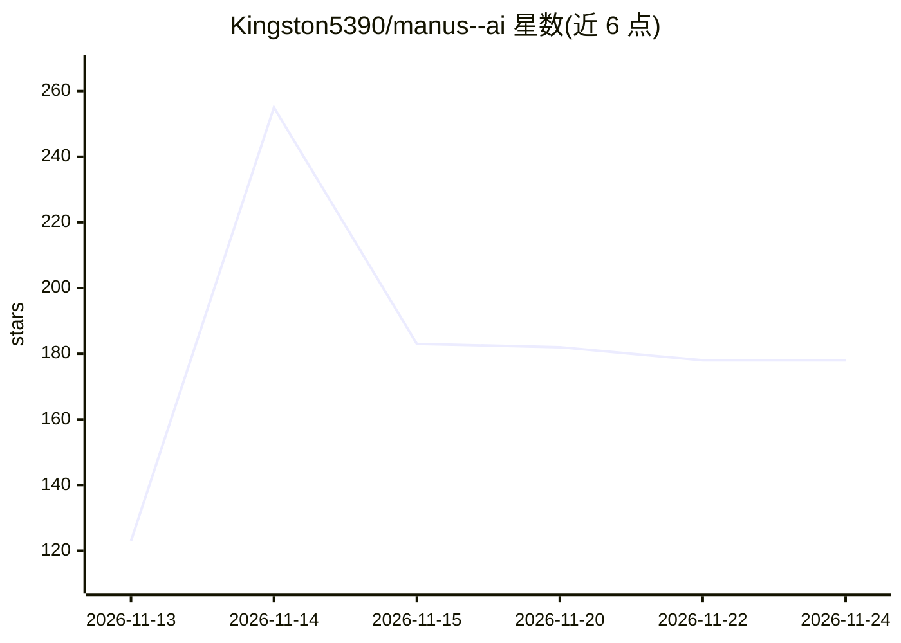

# Kingston5390/manus--ai

⭐ 174 · Apache-2.0 · 推送 2026-11-15 · [GitHub](https://github.com/Kingston5390/manus--ai) · 个人维护

**面向个人用户的自主 AI Agent：代为执行代码与浏览器操作**

自称 Manus 的自主 AI Agent，按 README 描述可在最少监督下编写并执行脚本、控制浏览器（导航网页、填表、采集信息）并执行多步骤任务，定位为家庭、学习与轻量办公场景的后台个人助手，代码执行与浏览器操作可在同一任务流中衔接。README 仅给出概念说明、兼容性表（最低 4 GB 内存、双核 CPU）与使用步骤，未提供安装命令、代码入口或模型接入说明，实际可用性无法从 README 验证。

## 筛选速览

| 维度 | 判定 | 备注 |
|---|---|---|
| AI 角色 | `ai-native` | 本体是模型或模型工具 |
| 许可风险 | `permissive` | Apache-2.0 |
| 部署形态 | `None` |  |
| 模型依赖 | — | README 未给出锁定关系 |
| 硬件要求 | — | 无带数字的原话,不猜 |
| 安装摩擦 | `low` | 无编译、无系统依赖或容器化 |
| 成熟度 | — | 结构信号不足 |

## 能力要点

- 自主执行代码：编写并运行脚本完成任务
- 浏览器控制：导航网页、填表、采集信息
- 代码与浏览器操作在同一任务流中衔接，支持多步骤任务
- 定位家庭/学习/轻量办公的小规模场景，按会话记忆工作流模式

## 适用场景

- 让学生整理研究笔记、运行小脚本与快速计算
- 让 agent 代为浏览多个网页收集数据并汇总
- 把重复性的表单填写、文件检查等杂务委派给后台助手

## 场景标签

`AI 助手` `编码 Agent` `浏览器自动化` · 领域:效率与自动化

## 证据(README 行号)

> L18: Manus is an autonomous AI agent designed to run code and control a browser on your behalf. Instead of acting like a
> L10: - **Autonomous Code Execution:** Manus AI agent runs code on its own to complete tasks, so you can focus on decisio

## 星数曲线

2026-11-13 123 → 2026-11-24 178（+55）

---
*卡片 v1 · prompt 1.4 · 生成 2026-11-17 · 置信度 mid · 依据 README sha `a3d88e202bf0` · [字段定义](../../DATASET.md)*
