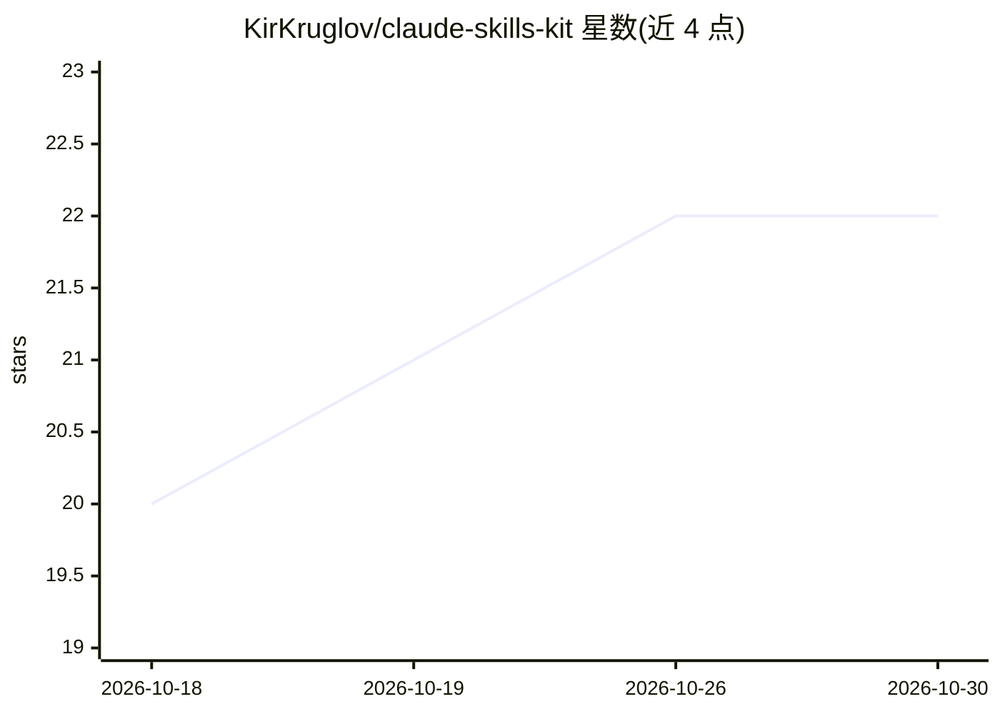

# KirKruglov/claude-skills-kit

⭐ 22 · MIT · 推送 2026-07-27 · [GitHub](https://github.com/KirKruglov/claude-skills-kit) · 个人维护 · 中文 README

**面向非技术用户的 Claude agent 技能策展包（77 个）**

为 Claude.ai、Projects 与 Cowork 整理的 77 个即用型 agent 技能合集（70 个独立技能 + project-management-kit 内 7 个嵌套技能），覆盖项目管理、团队领导、招聘 HR、产品发现、数据分析、财务与个人生产力等领域，按 8 类角色组织。每个技能是一个含 SKILL.md 的文件夹，附带中英/英俄双语 README、用户指南与安装说明；安装方式为复制技能文件夹到 Cowork 工作区或将 SKILL.md 内容粘贴到 Project Instructions，无需代码、CLI 或配置。技能基于输入（笔记、CSV、文本）生成结构化文档（章程、风险登记、状态报告、面试记要等），多数无需外部集成。

## 筛选速览

| 维度 | 判定 | 备注 |
|---|---|---|
| AI 角色 | `ai-knowledge` | 知识聚合/清单类 |
| 许可风险 | `permissive` | MIT |
| 部署形态 | `None` |  |
| 模型依赖 | locked-api |  |
| 硬件要求 | — | 无带数字的原话,不猜 |
| 安装摩擦 | `low` | 无编译、无系统依赖或容器化 |
| 成熟度 | — | 结构信号不足 |

## 能力要点

- 77 个技能按 8 类角色与 6 大领域组织
- 每技能含 SKILL.md + 双语 README + 用户指南的完整包
- 安装为复制文件夹或粘贴指令，无代码无 CLI
- project-management-kit 提供 PMBoK/Agile 流程的 7 个嵌套技能

## 适用场景

- 让 Claude 按 PMBoK 流程生成项目章程、计划与收尾报告
- 把周报、站会、OKR 原始笔记整理成结构化汇报文档
- 无 HR/ATS 工具时生成职位描述、面试评分卡与入职计划

## 场景标签

`精选清单` `AI 写作` · 领域:内容生成

## 证据(README 行号)

> L10: 77 curated agent skills for Claude — designed for non-technical users across PM, operations, finance, HR, and indus
> L29: Most skill repositories contain only a `SKILL.md` file.
> L44: A skill is a folder containing a `SKILL.md` file with structured instructions for Claude. Add it to Claude.ai or Co

## 星数曲线

2026-10-18 20 → 2026-10-30 22（+2）

---
*卡片 v1 · prompt 1.4 · 生成 2026-10-27 · 置信度 high · 依据 README sha `064c816cd840` · [字段定义](../../DATASET.md)*
