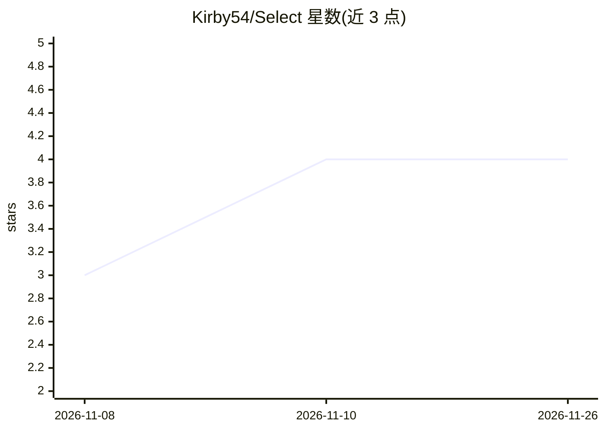

# Kirby54/Select

⭐ 4 · TypeScript · AGPL-3.0 · 推送 2026-11-09 · [GitHub](https://github.com/Kirby54/Select) · 个人维护

**自托管多 agent 编排平台：以代码验证与人工审批管理 agent 自主权**

自托管的公司任务管理平台，agent（开发、营销、客服、销售等角色）在其中执行任务，每次交付由独立 Python 库 select-verify 按任务类型的 YAML 契约做确定性校验并生成回执；agent 经连续验证成功后从人工监督逐级晋升到抽样、自主模式，出现阻断性失败或人工纠正即降级，付款、签约、税务、招聘等类别永久保留人工审批。支持 IMAP/SMTP 邮箱接入与预算、紧急停止、审计日志等运营控制。架构为 Next.js + FastAPI + PostgreSQL。维护者声明 1.0.0 为核心里程碑，未经生产安全认证，真实付费模型 API、OAuth 邮箱、沙箱代码执行尚未验证或不可用。

## 筛选速览

| 维度 | 判定 | 备注 |
|---|---|---|
| AI 角色 | `ai-ecosystem` | LLM/agent 周边工具 |
| 许可风险 | `viral` | AGPL-3.0 |
| 部署形态 | `self-host` | docker 或自建部署 |
| 模型依赖 | local-ok | 支持本地模型 |
| 硬件要求 | — | 无带数字的原话,不猜 |
| 安装摩擦 | `low` | 无编译、无系统依赖或容器化 |
| 成熟度 | `idea` | |

## 能力要点

- YAML 交付契约 + 确定性校验，生成含契约哈希与证据的验证回执
- 按 agent 与任务类型的自主权分级（监督/抽样/自主）与撤销机制
- 付款、签约、税务、招聘在代码层面强制人工审批
- demo company 无需 API key 即可本地体验

## 适用场景

- 让 AI agent 承担客服回复、报价等任务并保留人工审批环节
- 以验证记录逐步放开 agent 的自主执行范围
- 自托管管理团队任务、邮箱分诊与预算控制

## 场景标签

`多智能体` `Agent 框架` · 领域:Agent 开发

## 证据(README 行号)

> L20: Multi-agent orchestrators let you decide in advance what agents may do alone. Select replaces that guess with evide
> L119: Next.js 16 web app → FastAPI API → PostgreSQL 16, with a worker on a durable PostgreSQL job queue that runs agents

## 星数曲线

2026-11-08 3 → 2026-11-26 4（+1）

---
*卡片 v1 · prompt 1.4 · 生成 2026-11-21 · 置信度 high · 依据 README sha `86a58573ae6e` · [字段定义](../../DATASET.md)*
