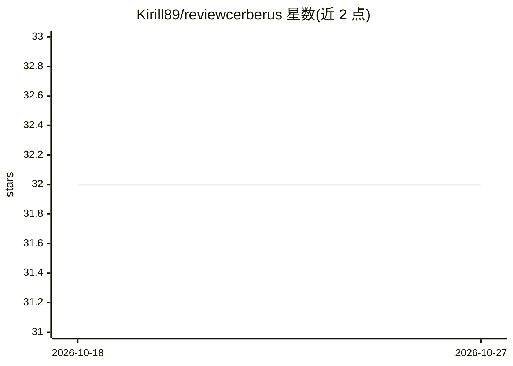

# Kirill89/reviewcerberus

⭐ 32 · Python · MIT · 推送 2026-08-04 · [GitHub](https://github.com/Kirill89/reviewcerberus) · 个人维护

**AI 代码审查工具：分析 git 分支差异并生成结构化审查报告**

面向开发者的代码审查 CLI 与 GitHub Action：检测当前 git 分支与目标分支的差异，将变更文件、提交信息与 diff 上下文交给 AI agent（可读取文件、跨代码库搜索），生成按严重度分级的问题表格与修复建议的 Markdown 报告。支持 AWS Bedrock、Anthropic API、Ollama、Moonshot 四种模型提供方，默认 Bedrock。提供实验性的 Chain-of-Verification 验证模式以降低误报，及 OpenGrep SAST 预扫描集成。推荐 Docker 运行，本地开发需 Python 3.11+ 与 Poetry。

## 筛选速览

| 维度 | 判定 | 备注 |
|---|---|---|
| AI 角色 | `ai-native` | 本体是模型或模型工具 |
| 许可风险 | `permissive` | MIT |
| 部署形态 | `self-host` | docker 或自建部署 |
| 模型依赖 | local-ok | 支持本地模型 |
| 硬件要求 | — | 无带数字的原话,不猜 |
| 安装摩擦 | `low` | 无编译、无系统依赖或容器化 |
| 成熟度 | `idea` | |

## 能力要点

- 分析 git 分支差异，输出按严重度（CRITICAL/HIGH/MEDIUM/LOW）分级的结构化审查报告
- 支持 AWS Bedrock、Anthropic API、Ollama、Moonshot 四种模型提供方
- 实验性 Chain-of-Verification 验证模式为每个问题附加 1-10 置信分
- GitHub Action 自动在 PR 上发布摘要与行内评论，可作为质量门禁

## 适用场景

- 在 PR 流程中自动生成代码审查评论
- 结合 SAST 预扫描审查安全问题与逻辑缺陷
- 以 fail_on 阈值作为 CI 质量门禁

## 场景标签

`代码审查` · 领域:编码与开发

## 证据(README 行号)

> L5: AI-powered code review tool that analyzes git branch differences and generates
> L14: - **Multi-Provider**: AWS Bedrock, Anthropic API, Ollama, or Moonshot
> L123: 3. **Analyzes** using AI agent with access to:

## 星数曲线

2026-10-18 32 → 2026-10-27 32（+0）

---
*卡片 v1 · prompt 1.4 · 生成 2026-10-26 · 置信度 high · 依据 README sha `9e1188d943cd` · [字段定义](../../DATASET.md)*
