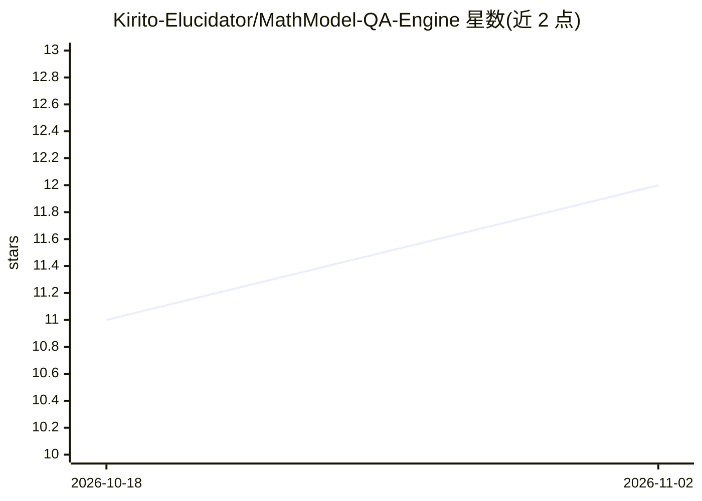

# Kirito-Elucidator/MathModel-QA-Engine

⭐ 12 · Python · MIT · 推送 2026-05-11 · [GitHub](https://github.com/Kirito-Elucidator/MathModel-QA-Engine) · 个人维护 · 中文 README

**面向数模备赛的 MCM/ICM 获奖论文 RAG 问答引擎**

基于 LlamaIndex 构建的检索增强生成系统，用于分析 MCM/ICM 等数学建模竞赛历年获奖论文。核心机制是按 Markdown 主标题做章节级分块，正则状态机自动归类为 13 种标准章节，每个节点携带 year/problem/section/doc_id 元数据，支持年份、题号、章节、文档 ID 任意组合过滤检索。提供多轮对话、跨年份同题型趋势对比、纯标题与目录节点过滤。API 层支持 OpenAI/DeepSeek/智谱等 OpenAI 兼容接口。以 CLI（build/chat）形式运行，需自备论文数据与 API key，数据集目录尚未上传。

## 筛选速览

| 维度 | 判定 | 备注 |
|---|---|---|
| AI 角色 | `ai-native` | 本体是模型或模型工具 |
| 许可风险 | `permissive` | MIT |
| 部署形态 | `library` | 以包/库形式分发 |
| 模型依赖 | — | README 未给出锁定关系 |
| 硬件要求 | — | 无带数字的原话,不猜 |
| 安装摩擦 | `low` | 无编译、无系统依赖或容器化 |
| 成熟度 | `idea` | |

## 能力要点

- 按 Markdown heading 章节级分块，正则状态机识别 13 类章节
- year/problem/section/doc_id 多维元数据过滤检索
- 支持 OpenAI/DeepSeek/智谱等 OpenAI 兼容接口
- 多轮对话与跨年份同题型趋势分析

## 适用场景

- 备赛时按年份/题号检索往年 O 奖论文特定章节的写法
- 横向对比历年 C 题论文的建模方法演变
- 拆解 Sensitivity Analysis 等章节的写作结构

## 场景标签

`RAG` `文档问答` · 领域:知识与检索

## 证据(README 行号)

> L3: **数学建模竞赛论文 RAG 问答引擎**
> L5: 基于 LlamaIndex 构建的检索增强生成（RAG）系统，专为分析 MCM/ICM （说不定还有国赛优化呢） 等数学建模竞赛历年获奖论文而设计。
> L49: |💬|**多轮对话**|基于 ChatMemoryBuffer 的上下文记忆，对话越深越精准|

## 星数曲线

2026-10-18 11 → 2026-11-02 12（+1）

---
*卡片 v1 · prompt 1.4 · 生成 2026-11-02 · 置信度 mid · 依据 README sha `019823e3eba9` · [字段定义](../../DATASET.md)*
