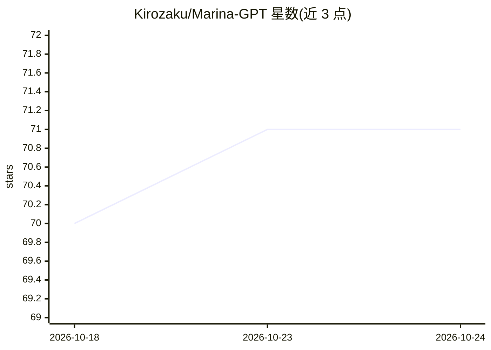

# Kirozaku/Marina-GPT

⭐ 71 · Python · MIT · 推送 2026-04-21 · [GitHub](https://github.com/Kirozaku/Marina-GPT) · [官网](https://github.com/Kirozaku/Marina-GPT/) · 个人维护

**面向渗透测试学习场景的无限制 CLI 聊天机器人**

包含 M.A.R.I.N.A 与 C.H.E.Y.Y 两个 Python 命令行聊天机器人，声称通过系统提示词绕过常见 AI 限制，提供上下文感知的对话，定位为辅助渗透测试流程与网络安全学习平台，声明仅供教育用途。支持 Kali Linux、Ubuntu、Debian 与 Termux 等环境，提供手动源码安装（git clone 后 pip 安装依赖）与下载可执行脚本的自动安装两种途径。

## 筛选速览

| 维度 | 判定 | 备注 |
|---|---|---|
| AI 角色 | `ai-native` | 本体是模型或模型工具 |
| 许可风险 | `permissive` | MIT |
| 部署形态 | `library` | 以包/库形式分发 |
| 模型依赖 | — | README 未给出锁定关系 |
| 硬件要求 | — | 无带数字的原话,不猜 |
| 安装摩擦 | `low` | 无编译、无系统依赖或容器化 |
| 成熟度 | — | 结构信号不足 |

## 能力要点

- 系统提示词设计用于绕过常见 AI 限制
- CLI 终端界面，含 M.A.R.I.N.A 与 C.H.E.Y.Y 两个入口
- 跨平台：Kali Linux/Ubuntu/Debian/Termux
- 提供手动安装与自动安装脚本两种途径

## 适用场景

- 在 Termux 或 Kali Linux 上运行命令行 AI 对话
- 网络安全与渗透测试学习场景的对话辅助

## 场景标签

`聊天机器人` `网络安全` · 领域:对话与助手

## 证据(README 行号)

> L14: - **Powerful AI Conversations:** Intelligent, context-aware responses.
> L15: - **Unrestricted Framework:** System prompts designed to bypass common AI limitations.
> L16: - **Simple CLI Interface:** Clean and easy-to-use terminal interface.

## 星数曲线

2026-10-18 70 → 2026-10-24 71（+1）

---
*卡片 v1 · prompt 1.4 · 生成 2026-10-24 · 置信度 mid · 依据 README sha `64dedfc60a67` · [字段定义](../../DATASET.md)*
